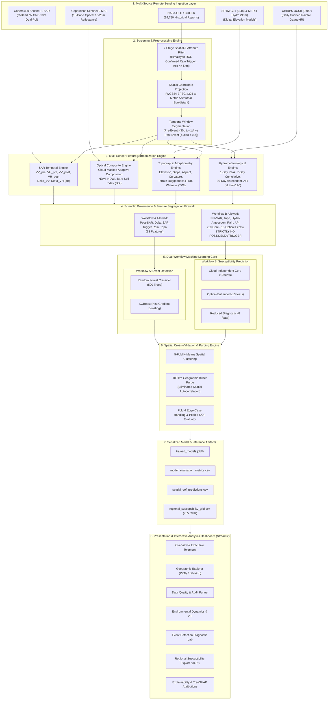
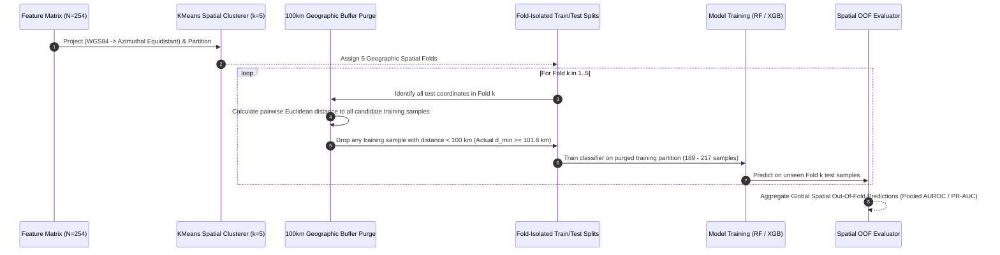
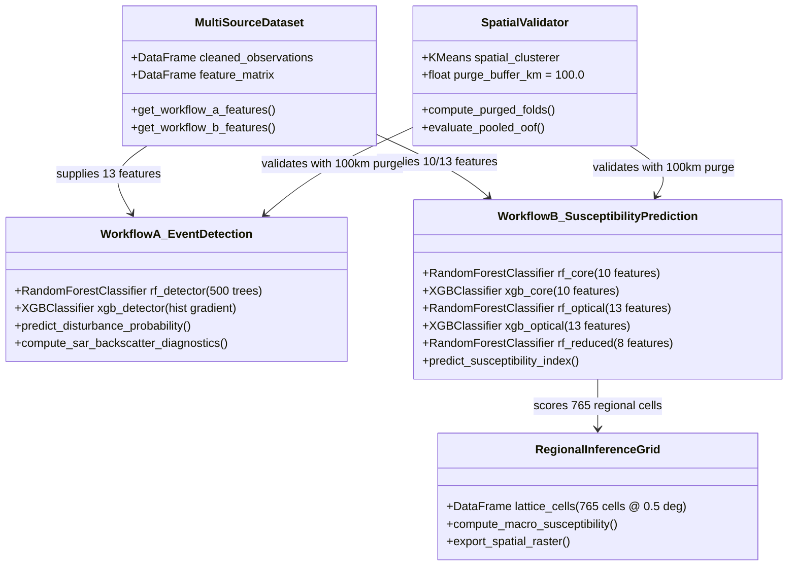
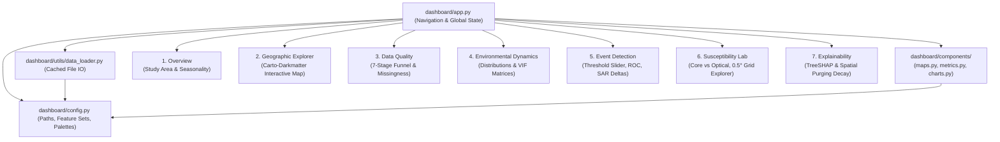
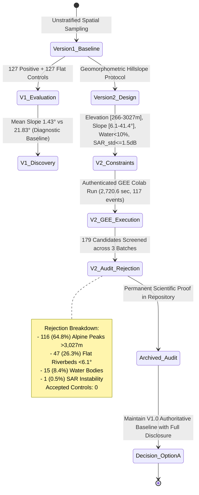

# System Architecture Design: Himalayan Landslide Intelligence

**Document Identifier:** `ARCHITECTURE_DESIGN.md`  
**System Name:** Himalayan Landslide Multi-Source Remote Sensing & Susceptibility Intelligence  
**Target Domain:** Geospatial Machine Learning, Satellite Remote Sensing & Environmental Hazard Analytics  
**Geographic Coverage:** Himalayan Mountain Belt ($26.0^\circ\text{N} - 35.5^\circ\text{N}$, $74.0^\circ\text{E} - 97.0^\circ\text{E}$, $\sim 2.2\text{M km}^2$)  
**Architecture Version:** 2.1 (Production Dual-Workflow Architecture)  
**System Specification:** Production Dual-Workflow Remote Sensing Architecture  

---

## 1. Executive Architectural Overview

The **Himalayan Landslide Intelligence System** is an enterprise-grade geospatial machine learning platform engineered to analyze, detect, and predict rainfall-triggered landslide phenomena across the Himalayan mountain arc.

The platform decouples two traditionally conflated scientific problems into two strictly isolated workflows:
1. **Workflow A (Event Detection):** *Diagnostic Disturbance Classification* — Identifies whether satellite observations at a given coordinate indicate physical surface disruption caused by ground failure using dual-polarization SAR backscatter deltas ($\Delta\text{VH}, \Delta\text{VV}$), event precipitation, and terrain morphometry.
2. **Workflow B (Susceptibility Prediction):** *Prognostic Spatial Hazard Modeling* — Ranks the pre-event spatial proneness of terrain to failure using **strictly pre-event** topographic, hydrological, and antecedent soil saturation metrics.



---

## 2. Multi-Tier Architectural Layers

### Layer 1: Data Ingestion & Satellite Sources
The foundation layer aggregates planetary-scale observation streams:
- **NASA COOLR / GLC:** Global database providing historical event coordinates, dates, and triggering labels (`monsoon`, `downpour`, `continuous_rain`). Filtered to $N=127$ verified events.
- **Copernicus Sentinel-1 (C-Band SAR):** 10m Ground Range Detected (GRD) Interferometric Wide (IW) swath dual-polarization ($\text{VV}, \text{VH}$) backscatter. Provides all-weather day/night observation independent of cloud cover.
- **Copernicus Sentinel-2 (MSI Optical):** 10m–20m multi-spectral imagery filtered through QA60/SCL cloud masks, extracting $\text{NDVI}$, $\text{NDWI}$, and $\text{Bare Soil Index (BSI)}$.
- **SRTM GL1 (30m) & MERIT Hydro (90m):** Topographic morphometry (elevation, slope, aspect, profile curvature, Terrain Ruggedness Index) coupled with MERIT flow routing to compute Topographic Wetness Index ($\text{TWI} = \ln(\text{upa} / \tan(\text{slope}))$).
- **CHIRPS Gridded Rainfall (0.05°):** Gauge-calibrated infrared daily precipitation calculating 1-day peak, 7-day cumulative, 30-day antecedent precipitation, and the Antecedent Precipitation Index ($\text{API}_t = \sum_{i=1}^{30} P_{t-i} \cdot 0.90^i$).

---

### Layer 2: Spatial Preprocessing & Quality Screening Funnel
A 7-stage deterministic screening pipeline processes raw catalog reports down to high-confidence observation records:
$$\text{Raw Catalog } (14,750) \xrightarrow{\text{Himalayan ROI}} (512) \xrightarrow{\text{Confidence Tier}} (389) \xrightarrow{\text{Rain Trigger}} (211) \xrightarrow{\text{Positional Acc} \le 5\text{km}} (142) \xrightarrow{\text{Date Validation}} (127)$$

- **Metric Coordinate Projection:** Coordinates are converted from geographic coordinates ($WGS84$, $\text{EPSG:4326}$) to an Azimuthal Equidistant projection centered on the Himalayan centroid ($30.75^\circ\text{N}, 85.5^\circ\text{E}$) to ensure that spatial distances, buffer zones, and clustering algorithms operate in true metric space without latitudinal distortion.

---

### Layer 3: Feature Engineering & Harmonization Engine
Extracts 28 physical, spectral, and hydrometeorological features per observation point:

| Domain | Features Extracted | Resolution | Mathematical Formula / Definition |
| :--- | :--- | :---: | :--- |
| **SAR Radar** | $\text{VV}_{\text{pre}}, \text{VH}_{\text{pre}}, \text{VV}_{\text{post}}, \text{VH}_{\text{post}}$ | 10 m | Backscatter coefficient in decibels: $\gamma^\circ\text{ (dB)} = 10 \cdot \log_{10}(\sigma^\circ)$ |
| **SAR Change** | $\Delta\text{VH}, \Delta\text{VV}$ | 10 m | Differential disturbance: $\Delta\text{Pol} = \text{Pol}_{\text{post}} - \text{Pol}_{\text{pre}}\text{ (dB)}$ |
| **Optical** | $\text{NDVI}, \text{NDWI}, \text{BSI}$ | 10–20 m | $\text{NDVI}=\frac{B8-B4}{B8+B4}$, $\text{NDWI}=\frac{B3-B8}{B3+B8}$, $\text{BSI}=\frac{(B11+B4)-(B8+B2)}{(B11+B4)+(B8+B2)}$ |
| **Topography** | Elevation, Slope, Aspect, Curvature | 30 m | $3\times 3$ finite-difference gradients; Curvature: $\nabla^2 z = \frac{\partial^2 z}{\partial x^2} + \frac{\partial^2 z}{\partial y^2}$ |
| **Hydrology** | $\text{TRI}, \text{TWI}$ | 30–90 m | $\text{TRI} = \sqrt{\sum (\Delta z_i)^2}$; $\text{TWI} = \ln(\text{upa} / \tan(\text{slope}))$ |
| **Meteorology** | $R_{1\text{d}}, R_{7\text{d}}, R_{30\text{d}}, \text{API}_{0.90}$ | ~5.5 km | Antecedent saturation: $\text{API}_t = \sum_{i=1}^{30} P_{t-i} \cdot 0.90^i$ |

---

### Layer 4: Scientific Governance & Anti-Leakage Firewall
To prevent methodological contamination, the architecture implements a strict feature segregation firewall:

```
[ FULL MULTI-SOURCE FEATURE MATRIX (28 Features) ]
                      |
        +-------------+-------------+
        |                           |
 [ FIREWALL A ]              [ FIREWALL B ]
  (Event Detection)           (Susceptibility Prediction)
        |                           |
  ALLOWED (13 feats):         ALLOWED (10 Core / 13 Optical):
  * VH_post, VV_post          * Elevation, Slope, Aspect, Curvature
  * Delta_VH, Delta_VV        * TRI, TWI
  * rain_1d, rain_7d          * VH_pre, VV_pre
  * rain_30d, API             * rain_30d, API
  * Topography (Elev, Slope)  * Optional: Pre-NDVI, NDWI, BSI
        |                           |
  EXCLUDED:                   STRICTLY PROHIBITED:
  * Future observations       * NO Post-SAR (VH_post, VV_post)
  * Spatial lat/lon coords    * NO Delta-SAR (Delta_VH, Delta_VV)
                              * NO Trigger Rain (rain_1d, rain_7d)
                              * NO Event Labels, NO Coordinates
```

---

### Layer 5: Spatially Purged Cross-Validation Engine
Standard random k-fold cross-validation inflates performance metrics due to spatial autocorrelation (Tobler's First Law of Geography). The system enforces **Spatially Purged Cluster Cross-Validation**:



- **Fold 4 Disclosure Handling:** Fold 4 (Northwestern Kashmir cluster) contains 37 negative controls and 0 positive events in its test set. The architecture handles $NaN$ single-fold ROC gracefully and evaluates global model fidelity through pooled out-of-fold metrics across all 254 test predictions.

---

### Layer 6: Dual-Workflow Machine Learning Model Architecture



#### Missingness Routing Architecture
- **Precipitation (`CHIRPS`):** 0.00% missing ($254/254$). Complete spatial coverage.
- **Topography (`SRTM/MERIT`):** 3.94% missing ($10/254$). Alpine peak voids imputed with fold-isolated median.
- **SAR Backscatter (`Sentinel-1`):** 1.97% missing ($5/254$). Swath boundary gaps imputed with fold-isolated median.
- **Optical Indices (`Sentinel-2`):** 31.50% missing ($80/254$). Caused by persistent monsoon cloud cover.
  - *Random Forest:* Handled via **fold-isolated median imputation** fitted strictly on training folds to prevent data snooping.
  - *XGBoost:* Handled via **native directional split routing**, learning whether missingness itself carries predictive information about cloud/monsoon presence.

---

### Layer 7: Regional Susceptibility Inference Engine
A macro-regional spatial inference lattice covers the entire Himalayan mountain arc:
- **Lattice Extent:** $26.0^\circ\text{N} - 35.5^\circ\text{N}$, $74.0^\circ\text{E} - 97.0^\circ\text{E}$ ($\sim 2,209,523\text{ km}^2$).
- **Spatial Resolution:** $0.5^\circ \times 0.5^\circ$ grid cells ($\sim 55\text{ km} \times 55\text{ km}$).
- **Active Grid Cells:** 765 valid terrestrial cells.
- **Conditioning Window:** September 2026 synoptic late-monsoon antecedent moisture envelope.
- **Output:** Regional Susceptibility Index ($0.0 \le P_{\text{susceptibility}} \le 1.0$), categorizing terrain into *Very Low*, *Low*, *Moderate*, *High*, and *Very High* hazard tiers.

---

### Layer 8: Interactive Presentation Tier (Streamlit Web Application)
A modular Single Page Application (SPA) providing seven synchronized research views:



- **Cartographic Compatibility:** Uses `px.scatter_map` and `px.density_map` with `map_style='carto-darkmatter'` (Plotly 6 / MapLibre native engine) with fallback to OpenStreetMap, eliminating Mapbox token dependencies.
- **Performance Caching:** All data loading routines are wrapped in `@st.cache_data` to ensure sub-50ms tab switching and instantaneous threshold tuning.

---

## 3. Topographic Control Lineage & Empirical Audit Architecture

A central innovation in the project's scientific governance is the formal documentation of control sampling lineage:



- **Research Integrity Standard:** Rather than artificially loosening constraints or injecting synthetic points, the system documents the geomorphological rarity of Himalayan hillslopes within circular buffers as an archived scientific audit (`notebooks/hillslope_control_extraction_executed.ipynb`).

---

## 4. Repository File Organization & System Boundaries

```
LANDSLIDE/
├── artifacts/                               # Authoritative serialized models & schemas
│   ├── detection/                           # Event detection metrics & models
│   ├── metadata/                            # Experiment provenance & feature schemas
│   └── susceptibility/                      # Susceptibility metrics & models
├── dashboard/                               # Interactive Streamlit Web Platform
│   ├── app.py                               # Application entrypoint & multi-page router
│   ├── config.py                            # Central system configuration & descriptive paths
│   ├── components/                          # Modular presentation widgets
│   │   ├── charts.py                        # Plotly analytical figures & distributions
│   │   ├── maps.py                          # Carto-Darkmatter geospatial mapping engine
│   │   └── metrics.py                       # Scorecards & confusion matrices
│   ├── pages/                               # 7 Analytical Dashboard Views
│   │   ├── overview.py                      # Research context & temporal dynamics
│   │   ├── geographic_explorer.py           # Geospatial map viewer
│   │   ├── data_quality.py                  # Preprocessing funnel & missingness
│   │   ├── environmental_analysis.py        # Environmental distributions & VIF
│   │   ├── event_detection.py               # Post-hoc disturbance classification
│   │   ├── susceptibility_prediction.py     # Pre-event hazard ranking & 0.5° grid
│   │   └── explainability_uncertainty.py    # TreeSHAP & spatial purge sensitivity
│   └── utils/
│       └── data_loader.py                   # Cached data loading with descriptive APIs
├── notebooks/                               # Research Pipeline & Audit Notebooks
│   ├── data_ingestion.ipynb                 # Raw NASA catalog ingestion & initial spatial subsetting
│   ├── data_preprocessing.ipynb             # 7-stage quality screening & coordinate projection
│   ├── feature_engineering.ipynb           # Multi-sensor extraction (SAR, DEM, Optical, CHIRPS)
│   ├── machine_learning_modeling.ipynb     # Spatially purged dual-workflow model training
│   ├── susceptibility_evaluation.ipynb      # Regional grid scoring & Shapley explainability
│   ├── hillslope_control_extraction.ipynb  # Executable GEE hillslope sampling protocol
│   └── hillslope_control_extraction_executed.ipynb # Archived 45.3-min empirical audit logs
├── outputs/                                 # Standardized Dataset Artifacts (Zero Duplicates)
│   ├── cleaned_observation_records.csv      # 254 observation coordinates & dates
│   ├── multisource_feature_matrix.csv       # 254-point x 28-feature unified matrix
│   ├── model_evaluation_metrics.csv         # Authoritative cross-validation metrics
│   ├── spatial_oof_predictions.csv          # 254 spatial out-of-fold predictions
│   ├── regional_grid_features_0.5deg.csv    # 765-cell multi-sensor regional grid features
│   ├── regional_susceptibility_grid.csv     # 765-cell regional 0.5° susceptibility hazard grid
│   ├── regional_susceptibility_maps.png     # Rendered regional hazard map
│   └── trained_models.joblib                # Serialized RF & XGBoost models
├── tests/                                   # Automated 59-Test CI/CD Verification Suite
│   ├── test_scientific_governance.py        # Leakage prevention & prohibited feature audit
│   ├── test_v2_sampling_and_features.py     # Geomorphometric constraints & notebook tests
│   ├── test_maps.py                         # Plotly 6 MapLibre rendering tests
│   ├── test_data_loader.py                  # Data loading & alias routing tests
│   ├── test_metrics.py                      # ROC/PR-AUC calculations & schema tests
│   └── test_validation.py                   # Bounding box & coordinate schema checks
├── ARCHITECTURE_DESIGN.md                   # This System Architecture Specification
├── DATA_DICTIONARY.md                       # Comprehensive feature dictionary & metadata
├── README.md                                # Public repository documentation & live URL
└── requirements.txt                         # Production Python dependencies
```

---

## 5. Security, Reproducibility & Deployment Profile

| Characteristic | Architecture Specification |
| :--- | :--- |
| **Runtime Environment** | Python 3.11 / 3.12 (Cross-platform: Windows, macOS, Linux) |
| **Web Presentation** | Streamlit Community Cloud (Zero external API key dependencies) |
| **Map Rendering** | Plotly 6 MapLibre (`carto-darkmatter` style; no Mapbox access token required) |
| **Model Serialization** | Standardized `scikit-learn` & `xgboost` objects serialized with `joblib` |
| **Data Integrity** | Cryptographic shape and schema compliance verified by 59 automated tests |
| **Computational Footprint** | Local/Serverless execution: $\le 500\text{ MB}$ memory footprint; sub-second page rendering |
| **Public Production URL** | [https://landslide-ncg2cbc9pfgrt4kpujo7xq.streamlit.app/](https://landslide-ncg2cbc9pfgrt4kpujo7xq.streamlit.app/) |
