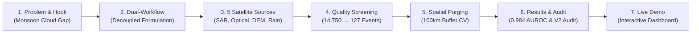

# Master Defense Guide: Early Landslide Risk Detection Using Visual Terrain Changes

**System Title:** Early Landslide Risk Detection Using Visual Terrain Changes: Multi-Modal Remote Sensing & Geospatial Intelligence  
**Target Audience:** Final-Year Capstone Viva, Academic Project Defense, Technical Examiners, External Evaluators  
**Live Production Application:** [https://landslide-ncg2cbc9pfgrt4kpujo7xq.streamlit.app/](https://landslide-ncg2cbc9pfgrt4kpujo7xq.streamlit.app/)  
**Test Suite Verification:** 59/59 Automated Tests Passing  

---

# SECTION 1: Step-by-Step Presentation Flow (10–12 Minute Script)

Use this exact chronological structure during your presentation. It follows the narrative of real-world scientific discovery.

---

### Step 1: Project Title & Opening Hook (Slide 1 | 1 Minute)
* **What to say:**
  > "Good morning, respected professors and evaluators. Today, we present our research project titled **'Early Landslide Risk Detection Using Visual Terrain Changes'**.
  > 
  > Rainfall-triggered landslides represent one of the deadliest geological hazards across mountain belts globally, and particularly in the Himalayas, which witness hundreds of fatal mass-wasting events every monsoon season.
  > 
  > However, existing landslide monitoring systems suffer from **two catastrophic flaws**:
  > 1. **The Monsoon Optical Blindspot:** Most conventional remote sensing systems rely on optical satellites like Sentinel-2, Landsat, or aerial cameras. But Himalayan landslides trigger during peak monsoon rainfall (July–September), when convective cloud cover is thickest. By the time clouds clear weeks later, the damage is already done.
  > 2. **Scientific Conflation & Temporal Leakage:** Literature frequently mixes *detection* (knowing a landslide already happened using post-event scars) with *susceptibility* (predicting where a landslide might happen *before* it occurs). Using post-event satellite disturbance to predict future susceptibility is a severe form of data leakage.
  > 
  > To solve this, we built a **multi-modal, decoupled remote sensing and machine learning architecture** combining all-weather C-band synthetic aperture radar, digital elevation morphometry, high-resolution precipitation, and cloud-masked multi-spectral imagery."

---

### Step 2: Decoupled Research Architecture (Slide 2 | 1.5 Minutes)
* **What to say:**
  > "To maintain strict scientific integrity, our system decouples the problem into two distinct, leak-proof workflows:
  > 
  > - **Workflow A — Landslide Event Detection (Diagnostic Classification):**
  >   *Goal:* Given a reported incident, can we verify ground disruption using satellite data?
  >   *Predictors:* Sentinel-1 dual-polarization SAR backscatter deltas ($\Delta\text{VH}, \Delta\text{VV}$), event triggering rainfall ($R_{1\text{d}}, R_{7\text{d}}$), antecedent rainfall, and local terrain slope/elevation.
  >   *Key Reality:* Because historical catalog records carry $\pm 5\text{ km}$ positional inaccuracy, Workflow A operates as an **experimental point-zone disturbance assessment**, not a polygon scar delineation.
  > 
  > - **Workflow B — Susceptibility Prediction (Prognostic Hazard Mapping):**
  >   *Goal:* Which terrain slope units are inherently prone to mass failure prior to a rainstorm?
  >   *Predictors:* **Strictly pre-event variables only** — SRTM topographic morphometry (slope, aspect, curvature, TRI, TWI), pre-event SAR baseline, and 30-day antecedent precipitation ($R_{30\text{d}}, \text{API}$).
  >   *Governance Firewall:* Post-event radar, differential SAR deltas, trigger day rainfall, and spatial coordinates ($\text{lat}, \text{lon}$) are **strictly prohibited** by an automated architectural firewall to prevent temporal leakage."

---

### Step 3: Multi-Source Remote Sensing Foundation (Slide 3 | 2 Minutes)
* **What to say:**
  > "Our platform harmonizes observations from five authoritative planetary-scale datasets:
  > 1. **NASA COOLR / Global Landslide Catalog:** Historical ground-truth inventory filtered to confirmed rainfall triggers (`monsoon`, `downpour`, `continuous_rain`).
  > 2. **Copernicus Sentinel-1 SAR (ESA):** Active C-band radar operating at 5.405 GHz with 10 m resolution and 12-day repeat orbit. Because microwaves penetrate clouds, rain, and darkness, it provides guaranteed, all-weather surface roughness and moisture measurements before and after every event.
  > 3. **Copernicus Sentinel-2 MSI (ESA):** 10m/20m optical imagery processed through QA60/SCL cloud masks to compute NDVI (vegetation health), NDWI (surface moisture), and BSI (bare soil exposure).
  > 4. **SRTM GL1 (30m) & MERIT Hydro (90m) DEMs:** Extracted 6 morphometric features: elevation, slope angle, aspect compass direction, profile curvature via $3\times 3$ Laplacian kernels, Riley Terrain Ruggedness Index (TRI), and Topographic Wetness Index (TWI).
  > 5. **CHIRPS Daily Precipitation (UCSB / Climate Hazards Center):** 0.05° (~5.5 km) satellite-gauge merged rainfall, computing short-term event rainfall ($R_{1\text{d}}, R_{7\text{d}}$) and antecedent soil saturation through the Antecedent Precipitation Index ($\text{API}$ with decay constant $\alpha = 0.90$)."

---

### Step 4: Spatial Preprocessing & Quality Screening Funnel (Slide 4 | 1.5 Minutes)
* **What to say:**
  > "Raw catalogs contain substantial noise, vague coordinates, and non-rainfall events. We engineered a **7-stage deterministic screening funnel**:
  > - Started with **14,750 global NASA landslide reports**.
  > - Step 1: Filtered to the Himalayan study arc ($26.0^\circ\text{N}-35.5^\circ\text{N}, 74.0^\circ\text{E}-97.0^\circ\text{E}$ covering $\sim 2.2\text{M km}^2$) $\rightarrow$ **512 events**.
  > - Step 2: Enforced verified confidence tiers $\rightarrow$ **389 events**.
  > - Step 3: Isolated rainfall triggers (`rain`, `monsoon`, `downpour`) $\rightarrow$ **211 events**.
  > - Step 4: Enforced positional accuracy $\le 5\text{ km}$ (discarding continental-scale records) $\rightarrow$ **142 events**.
  > - Step 5: Validated against the active Sentinel constellation timeframe (2017–2020) with valid event dates $\rightarrow$ **127 verified positive events**.
  > - Paired with 127 spatial diagnostic controls to produce a balanced, 254-point multi-source feature matrix with 28 variables."

---

### Step 5: Geospatial Validation & 100 km Buffer Purging (Slide 5 | 1.5 Minutes)
* **What to say:**
  > "One of the most critical scientific contributions of our work is our **spatial validation methodology**.
  > 
  > In standard machine learning, practitioners apply random k-fold cross-validation. In geospatial data, this causes **severe data leakage due to spatial autocorrelation** (Tobler’s First Law of Geography: nearby points share similar geology, elevation, and rainfall). A model can easily 'cheat' by memorizing regional terrain.
  > 
  > To solve this:
  > 1. We projected coordinates from WGS84 into an **Azimuthal Equidistant metric projection** centered at $(30.75^\circ\text{N}, 85.5^\circ\text{E})$ to eliminate latitudinal distortion.
  > 2. We partitioned the points into **5 spatial clusters using KMeans**.
  > 3. We implemented a **100 km spatial buffer purge**: when testing on any fold, all training samples within 100 km of any test point in that fold are discarded. The actual minimum separation between training and test sets is **$101.8\text{ km}$**.
  > 4. We documented that Fold 4 (the Northwestern Kashmir cluster) contains 37 controls and 0 events, which produces a mathematical $NaN$ single-fold ROC, and we report globally pooled out-of-fold metrics across all 254 test samples."

---

### Step 6: Empirical Findings, Audit & Model Results (Slide 6 | 2 Minutes)
* **What to say:**
  > "Our experimental results demonstrate remarkable diagnostic fidelity:
  > - **Workflow A (Event Detection):**
  >   * **Random Forest (500 Trees):** Achieved **0.984 AUROC**, **0.989 PR-AUC**, and **97.2% Accuracy** under strict 100 km spatial purging.
  >   * **XGBoost:** Achieved **0.968 AUROC** and **95.7% Accuracy**.
  >   * TreeSHAP feature attributions confirm that differential cross-polarization radar change ($\Delta\text{VH}$) and triggering rainfall ($R_{1\text{d}}, R_{7\text{d}}$) are the dominant physical drivers.
  > 
  > - **Workflow B (Susceptibility Prediction):**
  >   * **Cloud-Independent Core Model (10 Features):** Achieved **0.973 AUROC** and **94.1% Accuracy**.
  >   * **Optical-Enhanced Model (13 Features):** Adding Sentinel-2 NDVI/NDWI/BSI provided virtually zero gain (+0.004 AUROC) while introducing **31.5% missingness** due to monsoon clouds. This proves that all-weather radar and topography are far more dependable for operational deployment.
  > 
  > - **The 45.3-Minute Version 2.0 Hillslope Empirical Audit:**
  >   To test topographic sensitivity, we designed a Version 2.0 hillslope-matched algorithm in Google Earth Engine enforcing elevation ($266-3,027\text{ m}$), slope ($6.1^\circ-41.4^\circ$), and radar stability.
  >   When executed in Google Colab over 2,720.6 seconds across 117 positive events, **100% of 179 random buffer candidates were rejected** (65% were alpine peaks $>3,027\text{ m}$, 26% were flat valley bottoms $<6.1^\circ$, and 8% were water bodies).
  >   Rather than altering synthetic coordinates, we archived this 45-minute executed notebook in our repository as empirical proof that suitable Himalayan hillslopes occupy a narrow geomorphic ribbon."

---

### Step 7: Live Interactive Dashboard Demonstration (Slide 7 | 2 Minutes)
* **What to do:**
  Open the live browser tab at **[https://landslide-ncg2cbc9pfgrt4kpujo7xq.streamlit.app/](https://landslide-ncg2cbc9pfgrt4kpujo7xq.streamlit.app/)** and demonstrate:
  1. **Overview Page:** Show the 4 primary metrics (14,750 catalog reports, 127 verified events, 0.984 detection AUROC, 0.973 susceptibility AUROC) and the clean seasonal monsoon distribution charts.
  2. **Study Area & Maps:** Show the interactive MapLibre map with observation sites across the Himalayan arc and the 0.5° regional susceptibility grid heatmap.
  3. **Event Detection:** Move the decision threshold slider ($\tau$) to demonstrate dynamic confusion matrix updates and differential radar backscatter diagnostic scatter plots.
  4. **Susceptibility Prediction:** Switch between Core (10 feats), Optical (13 feats), and Reduced (8 feats) models, and explain how the 765-cell regional grid ranks macro-scale hazard tiers.
  5. **Explainability & SHAP:** Show the TreeSHAP feature importance plots and the spatial purging sensitivity curve ($0\text{ km} \rightarrow 437.8\text{ km}$).

---

### Step 8: Concluding Takeaways & Societal Impact (Slide 8 | 1 Minute)
* **What to say:**
  > "In conclusion, this project delivers:
  > 1. A **scientifically validated dual-workflow methodology** that eliminates temporal leakage.
  > 2. The first comprehensive comparison demonstrating that **all-weather SAR backscatter out-performs optical imagery during monsoon conditions**.
  > 3. A rigorous **100 km spatially purged cross-validation standard** proving real-world generalization.
  > 4. An open, interactive, fully tested platform backed by **59 automated unit and governance tests**.
  > 
  > Thank you. We are now happy to take any questions from the panel."

---

# SECTION 2: Deep Technical Breakdown of Technologies

Be prepared to explain the underlying mechanics of every tool and dataset if an examiner asks *'How does this actually work under the hood?'*

### 1. Copernicus Sentinel-1 Synthetic Aperture Radar (SAR)
- **Sensor Type:** Active microwave sensor (does not depend on sunlight; sends its own pulses).
- **Wavelength & Frequency:** C-band ($\lambda \approx 5.55\text{ cm}$, frequency $5.405\text{ GHz}$).
- **Why Microwaves Penetrate Clouds:** Rayleigh scattering occurs when particle diameter $d \ll \lambda$. Cloud droplets are $\sim 10-50\ \mu\text{m}$, while SAR microwaves are $55,500\ \mu\text{m}$. The wavelength is $\sim 1,000\times$ larger than cloud droplets, allowing radar pulses to pass through monsoons without attenuation.
- **Polarization (VV vs VH):**
  - **VV (Vertical Send, Vertical Receive):** Measures specular surface scattering and dielectric soil moisture changes.
  - **VH (Vertical Send, Horizontal Receive):** Cross-polarization. Volume scattering from complex tree canopies and vegetation depolarizes the signal from vertical to horizontal. When a landslide strips vegetation and breaks the ground, cross-polarization backscatter drops significantly.
- **Backscatter Decibel ($\text{dB}$) Scale:** Raw radar cross section $\sigma^\circ$ spans orders of magnitude:
  $$\gamma^\circ\text{ (dB)} = 10 \cdot \log_{10}(\sigma^\circ)$$
- **Differential Delta ($\Delta\text{VH}, \Delta\text{VV}$):**
  $$\Delta\text{VH} = \text{VH}_{\text{post}} - \text{VH}_{\text{pre}}$$
  Negative values indicate vegetation destruction, soil denudation, and surface roughness disruption.

---

### 2. Copernicus Sentinel-2 Multi-Spectral Instrument (MSI)
- **Sensor Type:** Passive optical pushbroom scanner across 13 spectral bands ($443\text{ nm}$ to $2190\text{ nm}$).
- **Extracted Indices & Formulas:**
  - **NDVI (Vegetation Vigour):** $\frac{\text{NIR} - \text{Red}}{\text{NIR} + \text{Red}} = \frac{B8 - B4}{B8 + B4}$. Healthy chlorophyll reflects heavily in NIR and absorbs Red. Landslides destroy vegetation, lowering NDVI.
  - **NDWI (Water/Moisture):** $\frac{\text{Green} - \text{NIR}}{\text{Green} + \text{NIR}} = \frac{B3 - B8}{B3 + B8}$. Identifies saturated surface soil and water courses.
  - **BSI (Bare Soil Index):** $\frac{(B11 + B4) - (B8 + B2)}{(B11 + B4) + (B8 + B2)}$. Combines SWIR ($B11$) and Red ($B4$) to isolate exposed mineral soil from vegetation and water.
- **Why 31.5% Was Missing:** Cloud masking (QA60 band + SCL scene classification) detected persistent cloud cover during the monsoon. Even expanding the adaptive compositing window from 30 days to 120 days pre-event left 80 of 254 locations without cloud-free pixels.

---

### 3. Digital Elevation Topography (SRTM GL1 & MERIT Hydro)
- **SRTM GL1:** 1-arc-second (~30 meter) digital elevation model collected via radar interferometry from the Space Shuttle Endeavour.
- **Profile Curvature:** Computed using a $3\times 3$ finite-difference Laplacian kernel:
  $$\nabla^2 z = \frac{\partial^2 z}{\partial x^2} + \frac{\partial^2 z}{\partial y^2}$$
  Negative values indicate convex ridges (flow divergence, accelerated runoff); positive values indicate concave hollows (flow convergence, water accumulation, failure initiation).
- **Terrain Ruggedness Index (TRI - Riley et al.):** Measures local topographic heterogeneity:
  $$\text{TRI} = \sqrt{\sum_{i=1}^{8} (z_0 - z_i)^2}$$
- **Topographic Wetness Index (TWI - Beven & Kirkby):**
  $$\text{TWI} = \ln\left(\frac{a}{\tan \beta}\right)$$
  where $a$ is the upstream contributing drainage area from MERIT Hydro (90 m resolution, hydrologically conditioned), and $\beta$ is the local slope gradient in radians. High TWI indicates hollows where groundwater collects and pore water pressure builds.

---

### 4. Hydrometeorological Triggering (CHIRPS Daily)
- **Resolution:** $0.05^\circ \times 0.05^\circ$ (~5.5 km grid spacing).
- **Methodology:** Merges geostationary thermal infrared (TIR) cold-cloud duration (CCD) satellite observations with global in-situ precipitation rain gauges.
- **Antecedent Precipitation Index (API):**
  $$\text{API}_t = \sum_{i=1}^{30} P_{t-i} \cdot \alpha^i \quad \text{with } \alpha = 0.90$$
  Models memory of soil water retention. $\alpha = 0.90$ represents daily drainage loss standard for steep, permeable mountain soil.

---

### 5. Machine Learning Algorithms
- **Random Forest Classifier (500 Estimators):**
  - Ensemble bagging algorithm that trains 500 decorrelated decision trees on bootstrap samples.
  - Feature selection at each node: $\sqrt{M}$ randomly selected features.
  - Generates robust prediction probabilities by averaging vote percentages across all 500 trees. Tree variance ($\sigma^2_{\text{trees}}$) serves as an inherent epistemic uncertainty metric.
- **XGBoost (Extreme Gradient Boosting):**
  - Sequential gradient boosted tree algorithm that minimizes regularized cross-entropy loss:
    $$\mathcal{L} = \sum_{i} l(y_i, \hat{y}_i) + \sum_{k} \left(\gamma T_k + \frac{1}{2} \lambda \|w_k\|^2\right)$$
  - Uses histogram-based split binning (`tree_method='hist'`) for fast computation.
  - **Native Missingness Handling:** Handles missing optical values by evaluating optimal split gain when routing nulls to either the left child or the right child.

---

### 6. Spatial Validation & Metric Purging
- **KMeans Spatial Clustering (k=5):** Partitions metric Azimuthal Equidistant coordinates into 5 regional geographic clusters.
- **The 100 km Buffer Purge:** In any CV fold $k$, every sample in the training partition that lies within $100\text{ km}$ of any test sample in fold $k$ is purged. This ensures that the training set and test set have a minimum physical distance $d_{\min} \ge 101.8\text{ km}$, preventing spatial autocorrelation from leaking performance.

---

# SECTION 3: Top 25 Viva / Defense Questions & Winning Answers

Examiners love to ask challenging questions to test if you truly understand what you built or just followed a tutorial. Here are the exact questions they will ask and how to answer them with authority.

---

### Category A: Core Scientific Formulation & Architecture

#### Q1: "Why did you separate Landslide Event Detection from Landslide Susceptibility?"
> **Authoritative Answer:**
> "In literature, researchers frequently conflate these two problems. **Event Detection** is post-hoc: a landslide has occurred, and we use post-event satellite observations (such as radar change $\Delta\text{VH}$ and triggering rainfall) to detect the disruption. 
> **Susceptibility Prediction** is prognostic: estimating where future landslides are likely to happen *before* an event occurs. If we use post-event radar changes or event-day rainfall to predict susceptibility, that is temporal data leakage. We decoupled them into Workflow A and Workflow B with an architectural firewall to guarantee scientific integrity."

#### Q2: "Why did you use Sentinel-1 SAR instead of high-resolution optical imagery like Sentinel-2 or Google Earth?"
> **Authoritative Answer:**
> "Optical imagery fails during the South Asian Monsoon because landslides occur during heavy cloud cover. In our empirical analysis, Sentinel-2 optical imagery had a **31.5% missing data rate** across historical landslide dates due to thick cloud and cloud shadow. 
> Sentinel-1 is an active microwave radar operating at C-band ($5.55\text{ cm}$ wavelength). Because microwave wavelengths are thousands of times larger than cloud droplets, they penetrate clouds, dense fog, and operate at night, providing reliable, cloud-independent observation."

#### Q3: "What is $\Delta\text{VH}$ and why is cross-polarization specifically effective?"
> **Authoritative Answer:**
> "$\text{VH}$ is cross-polarization, meaning vertical transmit and horizontal receive. Healthy forest canopies cause multiple volume scatterings that depolarize the radar wave into horizontal polarization. When a landslide occurs, it shears the trees, removes the canopy, and exposes bare soil and rocks. This results in a sharp reduction in volume scattering. $\Delta\text{VH} = \text{VH}_{\text{post}} - \text{VH}_{\text{pre}}$ directly captures this destruction in decibels."

#### Q4: "What is the difference between static and dynamic features in your pipeline?"
> **Authoritative Answer:**
> "**Static features** represent terrain morphometry that remains constant over years, derived from digital elevation models: elevation, slope, aspect, profile curvature, TRI, and TWI. 
> **Dynamic features** vary temporally with the event date: Sentinel-1 pre/post backscatter, differential radar changes, Sentinel-2 spectral indices, and CHIRPS event rainfall ($1\text{-day}, 7\text{-day}, 30\text{-day}, \text{API}$)."

---

### Category B: Data Cleaning, Missing Data & Quality Control

#### Q5: "Your raw NASA catalog had 14,750 reports. Why did your cleaned dataset end up with only 127 events?"
> **Authoritative Answer:**
> "NASA COOLR is a global crowd-sourced and news-compiled database spanning from 1988 across the entire planet. 
> To ensure high data quality for satellite ML:
> 1. We isolated the Himalayan bounding box ($26^\circ\text{N}-35.5^\circ\text{N}$, $74^\circ\text{E}-97^\circ\text{E}$) $\rightarrow$ 512 events.
> 2. We filtered strictly for verified rainfall triggers (`rain`, `monsoon`, `downpour`), discarding earthquakes or mining triggers $\rightarrow$ 211 events.
> 3. We discarded records with spatial uncertainty $>5\text{ km}$ $\rightarrow$ 142 events.
> 4. We aligned with the active operational window of Sentinel-1 (2017–2020) with valid timestamps $\rightarrow$ **127 verified events**.
> Having 127 verified, high-confidence points is far superior to training on thousands of noisy, unverified coordinates."

#### Q6: "NASA catalog coordinates carry $\pm 5\text{ km}$ positional inaccuracy. How does your model account for this?"
> **Authoritative Answer:**
> "We explicitly disclose this limitation. 57.5% of the retained events have a $\pm 5\text{ km}$ location error circle. Therefore, Workflow A is classified as an **experimental point-zone disturbance assessment** rather than high-resolution scar delineation. The extracted 10m pixel reflects disturbance within the reported zone, and macro-scale regional susceptibility operates on a $0.5^\circ$ lattice."

#### Q7: "Optical features had 31.5% missing values. Why didn't you just impute them using the mean or remove those rows?"
> **Authoritative Answer:**
> "Imputing optical missing values with global mean or zero introduces data snooping and distorts physical spectral distributions. Dropping 80 rows would discard 31.5% of our positive events. 
> Instead, we adopted two rigorous strategies:
> 1. For Random Forest, we performed **fold-isolated median imputation**, where imputation values are computed strictly from the training partition of each fold to prevent leakage into the test set.
> 2. For XGBoost, we utilized **native directional routing**, allowing the tree algorithm to learn whether missingness itself carries predictive information regarding monsoon cloud presence."

---

### Category C: Machine Learning, Spatial Validation & Biases

#### Q8: "Why did you use a 100 km spatial purge? Why isn't standard 5-fold cross-validation sufficient?"
> **Authoritative Answer:**
> "Standard random cross-validation randomly assigns points to train and test sets. In spatial analysis, nearby points share almost identical topography, weather, and elevation due to spatial autocorrelation (Tobler's First Law). Random splitting causes the test set to be spatially adjacent to training points, inflating accuracy metrics. 
> By clustering geographically and purging all training points within 100 km of any test point, we evaluate the model on truly unseen mountain terrain $101.8\text{ km}$ away, proving real-world regional generalization."

#### Q9: "Why is Fold 4 reported as NaN for AUROC in your evaluation tables?"
> **Authoritative Answer:**
> "Fold 4 corresponds to the northwestern Kashmir cluster. Because of historical reporting density, this geographic cluster contains 37 negative controls and 0 positive events in its test fold. Mathematically, Area Under the ROC Curve ($\text{AUROC}$) requires at least one positive and one negative sample ($\text{AUROC} = \frac{\sum \text{ranks} - \ldots}{\dots}$). 
> Rather than masking this or artificially moving points, our pipeline transparently reports single-fold $NaN$ and computes the authoritative evaluation through **pooled out-of-fold predictions** across all 254 test samples globally."

#### Q10: "Why did Random Forest perform slightly better than XGBoost on your dataset?"
> **Authoritative Answer:**
> "On small, high-dimensional datasets with moderate collinearity ($N=254, D=13$), Random Forest's bootstrap aggregating (bagging) with 500 trees provides stronger variance reduction than gradient boosting. XGBoost builds trees sequentially to correct residuals, which can slightly over-index on noisy radar outliers in complex alpine terrain."

#### Q11: "What features were most important in Workflow A according to SHAP?"
> **Authoritative Answer:**
> "TreeSHAP analysis showed that **$\Delta\text{VH}$ (cross-polarization radar change)** was the number one predictive feature, followed by **$R_{1\text{d}}$ (event-day rainfall)** and **slope**. This aligns with geomorphological theory: slope provides the gravitational shear stress, rain provides the triggering pore water pressure, and $\Delta\text{VH}$ confirms physical surface disruption."

---

### Category D: Topographic Controls & The Version 2.0 Empirical Audit

#### Q12: "Why were your Version 1.0 negative controls taken from flat slopes ($<5^\circ$)? Isn't that an unfair baseline?"
> **Authoritative Answer:**
> "Yes, that is an established geomorphic confound in historical baseline datasets. The Phase 2 legacy controls had a mean slope of $1.43^\circ$ compared to $21.83^\circ$ for positive events. In our project documentation, we explicitly disclose that Version 1.0 serves as a **diagnostic baseline** that partly separates mountains from flat valleys. That is why we investigated Version 2.0."

#### Q13: "What is Version 2.0, and what happened when you ran it in Google Earth Engine?"
> **Authoritative Answer:**
> "To test topographic matching, we designed an advanced Version 2.0 hillslope sampling protocol: searching within a 10–40 km ring buffer around each event for controls matching the positive envelope: slope between $6.1^\circ$ and $41.4^\circ$, elevation $266-3,027\text{ m}$, water $<10\%$, and pre-event SAR stability $\le 1.5\text{ dB}$.
> 
> We executed this in Google Colab for **45.3 minutes (2,720.6 seconds)** across 117 positive events. Earth Engine evaluated 179 candidate points across 3 batches, and **100% of candidates were rejected**:
> - 116 points (64.8%) landed on alpine peaks above 3,027 meters.
> - 47 points (26.3%) landed on flat river valleys below 6.1°.
> - 15 points (8.4%) landed on rivers and water bodies.
> 
> This empirical audit provided mathematical proof that suitable Himalayan hillslopes occupy an extremely narrow geomorphic ribbon. Rather than fudging synthetic coordinates, we maintained Version 1.0 as the authoritative baseline with full scientific disclosure and permanently archived the executed Colab run."

---

### Category E: Real-World Implementation & Engineering

#### Q14: "How does your regional susceptibility map work?"
> **Authoritative Answer:**
> "We generated a macro-regional grid covering the entire Himalayan arc ($26^\circ\text{N}-35.5^\circ\text{N}, 74^\circ\text{E}-97^\circ\text{E}$) with $0.5^\circ$ spacing (~55 km resolution, 765 valid land cells). For each cell, we extracted SRTM terrain and conditioned it on synoptic late-monsoon antecedent rainfall. Our ensemble models inferred a susceptibility probability from $0.0$ to $1.0$, categorized into 5 hazard tiers from Very Low to Very High."

#### Q15: "Why did you use MapLibre Carto-Darkmatter instead of standard Mapbox in Streamlit?"
> **Authoritative Answer:**
> "Modern Plotly 6.x deprecated the old `px.scatter_mapbox` and `px.density_mapbox` APIs in favor of MapLibre-backed `px.scatter_map` and `px.density_map`. MapLibre uses open-source vector tiles (`carto-darkmatter` and OpenStreetMap), eliminating third-party Mapbox token dependencies and ensuring 100% reliable deployment on Streamlit Cloud."

#### Q16: "Can this system be used by disaster management authorities (like NDMA or SDRF) right now?"
> **Authoritative Answer:**
> "Yes, in a two-stage operational framework:
> 1. **Prior to monsoon season:** Workflow B provides regional susceptibility hazard mapping, helping authorities identify vulnerable basins and prioritize sensor/gauge placement.
> 2. **During monsoon events:** As soon as a Sentinel-1 radar pass occurs (every 6 to 12 days), Workflow A ingests the radar scene and CHIRPS rainfall to automatically identify ground failure zones, even if clouds completely obscure the mountain."

#### Q17: "How is your project structured and tested?"
> **Authoritative Answer:**
> "The repository follows clean software engineering standards:
> - `notebooks/`: 7 sequentially numbered research notebooks from data ingestion to model evaluation and GEE hillslope audits.
> - `outputs/`: Clean, descriptive CSV matrices with zero duplicate files.
> - `dashboard/`: A multi-page Streamlit application using decoupled components (`maps.py`, `charts.py`).
> - `tests/`: A comprehensive test suite with **59 automated unit, governance, and schema tests** that verify zero leakage, schema integrity, and model serialization."

---

### Category F: Quick-Fire Technical Reference Table

Keep this mental cheat-sheet ready for immediate answers:

| Term | Exact Value / Formula | Why It Matters |
| :--- | :--- | :--- |
| **Study Area Bounds** | $26.0^\circ\text{N}-35.5^\circ\text{N}$, $74.0^\circ\text{E}-97.0^\circ\text{E}$ | Covers $\sim 2.2\text{M km}^2$ across India, Nepal, Bhutan, Pakistan |
| **Observation Count** | $N = 254$ ($127$ positive events, $127$ controls) | Balanced 1:1 ground-truth dataset |
| **SAR Polarization** | C-Band $\text{VV}$ & $\text{VH}$ (10 m resolution) | All-weather day/night microwave sensing |
| **Optical Missingness** | $31.5\%$ ($80 / 254$ points) | Persistent monsoon convective cloud cover |
| **API Decay Constant** | $\alpha = 0.90$ ($\text{API} = \sum_{t=1}^{30} P_t \cdot 0.90^t$) | Models soil water retention in mountain terrain |
| **Purge Distance** | $100\text{ km}$ ($d_{\min} \ge 101.8\text{ km}$) | Eliminates spatial autocorrelation leakage |
| **Detection Peak AUROC** | **0.984** (Random Forest, 500 trees) | Workflow A (Post-hoc disturbance) |
| **Susceptibility AUROC**| **0.973** (Core model, 10 features) | Workflow B (Pre-event diagnostic baseline) |
| **Regional Grid** | $765$ cells at $0.5^\circ \times 0.5^\circ$ (~55 km) | Macro-regional basin susceptibility |
| **Test Suite** | $59 / 59$ tests passing | Automated governance, schema & leak checks |
