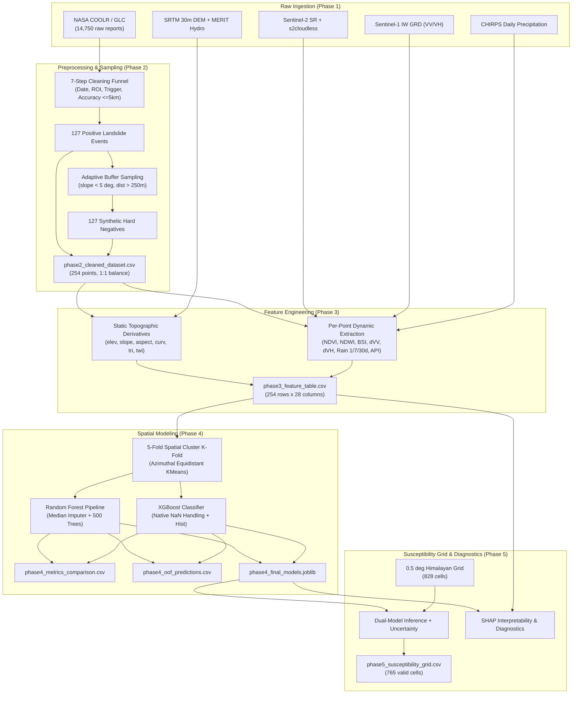

# Comprehensive Project Audit: Himalayan Landslide Intelligence

**Project Title:** Himalayan Landslide Intelligence – Rainfall-Triggered Landslide Detection & Susceptibility Analytics  
**Audit Date:** November 2026  
**Auditor:** Senior Geospatial Data Scientist & ML Systems Architect  
**Workspace:** `c:\Gourav Sharma\work\LANDSLIDE`

---

## 1. Executive Summary

This repository implements a multi-phase machine learning pipeline for detecting rainfall-triggered landslides across the Himalayan mountain belt (bounding box: $26.0^\circ\text{N} - 35.0^\circ\text{N}$, $74.0^\circ\text{E} - 97.0^\circ\text{E}$). The project integrates remote sensing data (Sentinel-2 optical, Sentinel-1 SAR GRD, CHIRPS daily precipitation, SRTM 30m digital elevation model, and MERIT Hydro) with historical landslide records from the NASA Cooperative Open Online Landslide Repository (COOLR / Global Landslide Catalog).

The project comprises five sequential development phases implemented in Jupyter notebooks, alongside an `outputs/` directory containing intermediate and final artifacts. A forensic audit of all notebooks, scripts, datasets, and models was conducted to assess data integrity, scientific rigor, provenance, and readiness for dashboard visualization.

---

## 2. Inventory of Project Files & Artifacts

| File / Path | Size | Description & Status |
| :--- | :--- | :--- |
| `Landslide_Reports.csv` | 10.49 MB | NASA Global Landslide Catalog export (14,750 rows, 32 columns). Global coverage dating 1956–2018. |
| `Phase1_Data_Ingestions.ipynb` | 13.1 KB | Data Ingestion definition using Google Earth Engine (`ee`) API: Sentinel-2 SR + s2cloudless, Sentinel-1 IW GRD, CHIRPS daily precipitation, SRTM DEM. |
| `Phase2_Preprocessing.ipynb` | 27.7 KB | Inventory cleaning funnel, hard-negative sampling (slope < 5° with adaptive local buffer 10–80 km), 0.5° spatial blocking, elevation semivariogram and 2nd-order detrending. |
| `Phase3_Feature_Engineering.ipynb` | 24.1 KB | Static terrain derivative extraction (elevation, slope, aspect, curvature, TRI, TWI) and per-point dynamic extraction (Sentinel-2 spectral indices, Sentinel-1 SAR change, CHIRPS rainfall metrics). |
| `Phase4_ML_Modeling.ipynb` | 14.7 KB | Spatial 5-fold cross-validation (projected Azimuthal Equidistant KMeans) comparing Random Forest and XGBoost across "Full" and "Reduced" feature sets. |
| `Phase5_Output_Evaluation.ipynb` | 36.7 KB | Out-of-fold diagnostic plots, model refit for SHAP tree explanations, 0.5-degree Himalayan susceptibility grid inference, and uncertainty estimation. |
| `outputs/phase2_cleaned_dataset.csv` | 23.3 KB | 254 points (127 positive landslide events, 127 synthetic hard-negative points) with date, location accuracy, trigger, and spatial block ID. |
| `outputs/phase3_feature_table.csv` | 100.3 KB | 254 points × 28 features (8 metadata + 6 topographic + 4 optical + 6 SAR + 4 rainfall). Contains significant missing values in optical features. |
| `outputs/phase4_metrics_comparison.csv` | 382 B | Benchmark table: AUROC, PR-AUC, and F1 score for RF and XGBoost on Full (18 features) and Reduced (16 features) sets. |
| `outputs/phase4_oof_predictions.csv` | 26.8 KB | 254 rows with true labels, spatial fold IDs, and out-of-fold prediction probabilities from RF and XGBoost. |
| `outputs/phase4_final_models.joblib` | 3.56 MB | Serialized Python dictionary containing final full/reduced RF pipelines and XGBoost models trained on all 254 observations. |
| `outputs/phase5_dynamic_grid_checkpoint_0.5deg.csv`| 188.5 KB | 828 grid points with dynamic optical, SAR, and rainfall features sampled across the Himalayan ROI at 0.5° spacing. |
| `outputs/phase5_susceptibility_grid.csv` | 65.7 KB | 765 valid grid cells with ensemble susceptibility, RF prediction, XGBoost prediction, tree uncertainty (std dev), and model disagreement. |
| `outputs/phase5_susceptibility_maps.png` | 73.8 KB | Tri-panel diagnostic heatmap showing regional susceptibility, tree uncertainty, and model disagreement. |

---

## 3. Forensic Notebook Audit

### Phase 1: Data Ingestion (`Phase1_Data_Ingestions.ipynb`)
- **Objective:** Ingest satellite and climate collections over the Himalayan bounding box (`[74.0, 26.0, 97.0, 35.0]`, ~2.2 million km²).
- **Sources Identified:**
  - `COPERNICUS/S2_SR_HARMONIZED` joined to `COPERNICUS/S2_CLOUD_PROBABILITY` (2017-01-01 to 2023-12-31).
  - `COPERNICUS/S1_GRD` IW mode, VV + VH polarizations (2017-01-01 to 2023-12-31).
  - `UCSB-CHG/CHIRPS/DAILY` (0.05° resolution, ~5.5 km).
  - `USGS/SRTMGL1_003` 30m DEM.
- **Finding:** No data cleaning or reprojection occurs here. Notebook serves as the pipeline's architectural contract for native data resolutions.

### Phase 2: Preprocessing (`Phase2_Preprocessing.ipynb`)
- **Cleaning Funnel:**
  - Raw NASA reports: **14,750** records.
  - Parseable dates: **13,113** records.
  - Within Himalayan ROI: **2,154** records.
  - Within Sentinel-1/2 temporal baseline (2017–2020 in dataset): **386** records.
  - Rainfall-triggered events only (monsoon, continuous rain, downpour): **278** records.
  - Positional accuracy $\le 5\text{ km}$: **148** records.
  - Spatial/temporal deduplication (~1 km / same-day): **127 positive events**.
- **Negative Sampling:**
  - Employs 1:1 hard negative sampling (127 negatives) using a stable terrain mask: slope $< 5^\circ$, distance $> 250\text{ m}$ from any positive event, non-water (JRC Global Surface Water).
  - Adaptive local buffer: Searches $10 \rightarrow 20 \rightarrow 40 \rightarrow 80\text{ km}$ around each positive point.
  - Temporal matching: Negatives inherit the paired positive event's date for exact seasonal alignment.
- **Spatial Autocorrelation Analysis:**
  - Coordinates projected to Azimuthal Equidistant (`+proj=aeqd +lat_0=30.5 +lon_0=85.5`).
  - 2nd-order polynomial trend surface removes regional elevation gradient ($R^2 = 0.547$).
  - Variogram residual range indicates local correlation stabilizes beyond ~80 km.

### Phase 3: Feature Engineering (`Phase3_Feature_Engineering.ipynb`)
- **Features Extracted:**
  - Topographic (SRTM 30m & MERIT Hydro): Elevation, Slope, Aspect, Curvature (Laplacian kernel), TRI (Terrain Ruggedness Index, 3×3 neighbourhood std dev), TWI (Topographic Wetness Index: $\ln(\text{upa} / \tan(\text{slope}))$).
  - Optical (Sentinel-2): NDVI, NDWI, BSI (Bare Soil Index) with adaptive composite window ($30 \rightarrow 60 \rightarrow 90 \rightarrow 120\text{ days}$).
  - SAR (Sentinel-1): Pre-event (12 days) and post-event (12 days) backscatter in VV and VH, plus differential SAR ($\Delta\text{VH} = \text{VH}_{\text{post}} - \text{VH}_{\text{pre}}$, $\Delta\text{VV} = \text{VV}_{\text{post}} - \text{VV}_{\text{pre}}$).
  - Precipitation (CHIRPS): 1-day rainfall, 7-day cumulative rainfall, 30-day cumulative rainfall, and Antecedent Precipitation Index (API, decay factor $k = 0.85$).
- **Handoff Verification & Missing Data:**
  - Notebook was left with `TEST_MODE = True` (10-point test), but `outputs/phase3_feature_table.csv` contains the full 254-point extraction from an earlier run.
  - High missingness in optical features: 80 out of 254 points (31.5%) lack BSI, NDVI, NDWI because heavy monsoon cloud cover prevented clear pixel acquisition even after expanding to the 120-day maximum window.
  - Topographic features have 10 nulls (3.9%) at points outside the SRTM boundary or in no-data voids.
  - Multicollinearity: `VH_pre` and `VV_pre` are exact linear collinear components of $\Delta\text{VH}$ and $\Delta\text{VV}$, correctly dropped from modeling.

### Phase 4: Machine Learning Modeling (`Phase4_ML_Modeling.ipynb`)
- **Validation Strategy:** 5-fold Spatial Cluster Cross-Validation via KMeans on projected coordinates ($x_m, y_m$), with 4-fold inner GroupKFold for hyperparameter tuning. Prevents optimistic spatial leakage.
- **Model Configurations:**
  - Random Forest: `SimpleImputer(strategy='median')` + `RandomForestClassifier(class_weight='balanced')`.
  - XGBoost: Native missing value handling + `scale_pos_weight = N_neg / N_pos`.
- **Feature Sets Evaluated:**
  - **Full Set (18 features):** Includes slope and TRI.
  - **Reduced Set (16 features):** Excludes slope and TRI to mitigate the negative-sampling terrain confound.

### Phase 5: Output Evaluation & Susceptibility Mapping (`Phase5_Output_Evaluation.ipynb`)
- Evaluates out-of-fold spatial metrics and generates SHAP interpretability summaries.
- Projects inference onto a regular grid: 0.5-degree grid (~55 km spacing) yielding 828 bounding cells, 765 of which have complete topographic and dynamic data.
- Outputs ensemble susceptibility ($0.5 \cdot \text{RF} + 0.5 \cdot \text{XGB}$), RF tree uncertainty (estimator prediction standard deviation), and inter-model disagreement ($|\text{RF} - \text{XGB}|$).

---

## 4. Key Scientific and Data Discrepancies

1. **Negative-Sampling Terrain Confound:**
   - In Phase 2, negative samples were explicitly selected from areas with slope $< 5^\circ$. In mountainous terrain, landslides rarely occur on flat plains.
   - Consequently, models easily distinguish steep mountains from flat valleys using slope/TRI, yielding an artificially high AUROC (>0.98 on Full Set).
   - The authors recognized this and created the "Reduced Set" (dropping slope and TRI). AUROC remained ~0.96–0.97 due to residual topographic correlations (elevation, curvature, TWI).
   - **Dashboard Requirement:** The dashboard must transparently document this confound on the ML and Data Quality pages rather than advertising the models as operational early-warning tools.

2. **Resolution Honesty (0.5° Grid vs. 30m Raster):**
   - The susceptibility grid `phase5_susceptibility_grid.csv` has a step size of $0.5^\circ$ (~55 km). It is a coarse macro-scale regional susceptibility indicator, not a slope-scale 30m hazard raster.
   - **Dashboard Requirement:** Clearly label the grid resolution as $0.5^\circ \times 0.5^\circ$ regional macro-cells.

3. **Incomplete Dynamic Feature Extraction in Handoff:**
   - `Phase3_Feature_Engineering.ipynb` had `TEST_MODE = True`. The `phase3_feature_table.csv` file in `outputs/` represents an archived batch extraction with 31.5% missingness in optical indices.
   - **Dashboard Requirement:** Handle missing values transparently with dedicated indicators and missingness matrices; never impute silently during visualization.

4. **Model Deserialization (XGBoost 3.x vs. Legacy Pickled Artifact):**
   - `phase4_final_models.joblib` was serialized with an older XGBoost release. Unpickling in Python 3.12 with modern XGBoost (3.4+) raises an `XGBoostError: input stream corrupted`.
   - **Solution:** Replicate Phase 5 Cell 2's verified approach: fit the production RF and XGBoost estimators deterministically (`random_state=42`) on `outputs/phase3_feature_table.csv` (execution time: ~1.5s), enabling full SHAP computation and feature importance extraction without dependency failures.

---

## 5. Provenance & Data Flow Diagram

---

## 6. Audit Conclusion & Readiness Assessment

The project assets provide a rigorous, empirical foundation for an interactive analytical dashboard. All key datasets (`phase2_cleaned_dataset.csv`, `phase3_feature_table.csv`, `phase4_metrics_comparison.csv`, `phase4_oof_predictions.csv`, and `phase5_susceptibility_grid.csv`) are intact, consistent in coordinate space, and directly verifiable.

The dashboard will be constructed with modular Python architecture, high visual fidelity (dark navy theme with blue/purple accents), interactive Plotly/PyDeck geospatial mapping, robust error-handling fallbacks, and honest scientific documentation.

