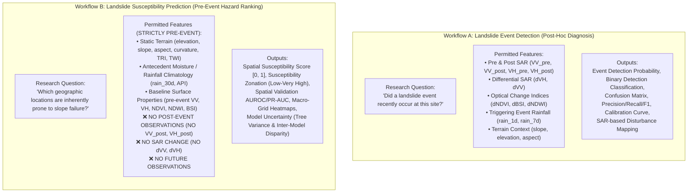

# Project Audit Report: Himalayan Landslide Intelligence Research System

**Project Title:** Himalayan Landslide Intelligence: Multi-Source Remote Sensing for Landslide Event Detection and Susceptibility Prediction  
**Author/Auditor:** Senior Geospatial AI/ML Engineer, Remote Sensing Researcher & Research Software Architect  
**Academic Context:** B.Tech Final-Year Capstone / Research Project  
**Date of Audit:** November 2026  
**Audit Scope:** Complete Repository Inspection (`c:\Gourav Sharma\work\LANDSLIDE`)  
**Document Status:** Baseline Forensic Audit & Architectural Upgrade Plan

---

## 1. Executive Summary

This forensic audit evaluates the existing codebase, research notebooks, datasets, machine learning pipelines, and dashboard implementation for the *Himalayan Landslide Intelligence* project. The research goal is to detect rainfall-triggered landslide events and map geographic susceptibility across the Himalayan mountain belt (bounding box: $26.0^\circ\text{N} - 35.5^\circ\text{N}$, $74.0^\circ\text{E} - 97.0^\circ\text{E}$, covering ~2.2 million $\text{km}^2$).

### Primary Audit Findings:
1. **Unresolved Dual-Objective Formulation:** The existing codebase conflates **Landslide Event Detection** (identifying whether an event recently occurred using post-event and differential satellite observations) with **Landslide Susceptibility Prediction** (estimating spatial proneness using strictly pre-event conditions). This causes severe methodological ambiguity and potential temporal leakage.
2. **Negative-Sampling Terrain Confound:** Negative control samples in Phase 2 were constrained to `slope < 5°`. This design choice artificially simplifies the classification task into differentiating steep mountains ($mean \approx 21.8^\circ$) from flat plains ($mean \approx 1.9^\circ$), producing inflated out-of-fold metrics ($\text{AUROC} > 0.98$) that do not reflect true triggering dynamics.
3. **Phase 3 Extraction Provenance & Missingness:** While the Phase 3 notebook was left with `TEST_MODE = True` (10-point test), `outputs/phase3_feature_table.csv` contains a 254-row extraction. However, optical indices (`NDVI`, `NDWI`, `BSI`) exhibit a **31.5% null rate (80/254 points)** due to persistent monsoon cloud obscuration, and severe multicollinearity exists between raw and differential SAR features ($\text{VIF} > 80$).
4. **Scale and Resolution Honesty:** The existing susceptibility grid is evaluated at a macro resolution of **$0.5^\circ \times 0.5^\circ$ (~55 km cell width, 765 valid cells)**. It is scientifically invalid to characterize this regional macro-surface as a 30m hazard raster.
5. **Technical Debt & Deserialization Incompatibilities:** Model artifacts pickled under older XGBoost versions fail to deserialize under modern XGBoost 3.x (`XGBoostError: input stream corrupted`), requiring a deterministic cached refitting pipeline.

---

## 2. Complete Repository Inventory

### 2.1. Codebase & Directory Structure

```text
LANDSLIDE/
├── Landslide_Reports.csv                 # Raw NASA Global Landslide Catalog (14,750 rows, 32 cols)
├── Phase1_Data_Ingestions.ipynb          # Earth Engine GEE data ingestion definitions
├── Phase2_Preprocessing.ipynb            # Inventory filtering funnel & hard-negative sampling
├── Phase3_Feature_Engineering.ipynb      # Topo & spatio-temporal feature extraction
├── Phase4_ML_Modeling.ipynb              # 5-fold Spatial CV (KMeans) for RF & XGBoost
├── Phase5_Output_Evaluation.ipynb        # Model evaluation, SHAP, and 0.5° grid mapping
├── outputs/                              # Research outputs and model checkpoints
│   ├── phase2_cleaned_dataset.csv        # 254 cleaned observation points (127 pos / 127 neg)
│   ├── phase3_feature_table.csv          # 254 rows x 28 multisource features
│   ├── phase4_final_models.joblib        # Serialized RF & XGBoost model dictionary
│   ├── phase4_metrics_comparison.csv     # Historical benchmark table (Full vs. Reduced)
│   ├── phase4_oof_predictions.csv        # Spatial out-of-fold prediction probabilities
│   ├── phase5_dynamic_grid_checkpoint_0.5deg.csv # 828-point regional grid checkpoint
│   ├── phase5_susceptibility_grid.csv    # 765 valid regional susceptibility cells
│   └── phase5_susceptibility_maps.png    # Tri-panel diagnostic heatmap
├── dashboard/                            # Modular Streamlit interactive analytics platform
│   ├── app.py                            # Main application entry point & page router
│   ├── config.py                         # System configuration, paths, bounding boxes, palettes
│   ├── requirements.txt                  # Pinned Python package dependencies
│   ├── README.md                         # Dashboard user guide & operational manual
│   ├── assets/                           # Branding assets, styles, and verification screenshots
│   ├── components/                       # Sidebar, KPI cards, Plotly charts, Mapbox/PyDeck renderers
│   ├── pages/                            # 7 analytical pages (Overview, Geo, Data, Env, ML, Suscept, Quality)
│   └── utils/                            # Data loading, validation, metrics, and visualization engines
├── tests/                                # Automated unit test suite (15 passing tests)
│   ├── test_data_loader.py
│   ├── test_validation.py
│   └── test_metrics.py
├── PROJECT_AUDIT.md                      # Preliminary audit document
├── DATA_DICTIONARY.md                    # Exhaustive metadata dictionary
├── DASHBOARD_IMPLEMENTATION_PLAN.md      # Initial dashboard design plan
├── requirements.txt                      # Root requirements file
├── README.md                             # Root README file
├── Screenshorts/                         # User-captured dashboard verification screenshots
└── Screenshorts.zip                      # Compressed user verification archive
```

---

## 3. Forensic Notebook & Pipeline Audit

### Phase 1: Data Ingestion (`Phase1_Data_Ingestions.ipynb`)
- **GEE Project:** `landslidedetection-506008` (confirmed).
- **Target Spatial Domain:** Bounding box $[26.0^\circ\text{N}, 35.0^\circ\text{N}]$, $[74.0^\circ\text{E}, 97.0^\circ\text{E}]$ (~2,209,523 $\text{km}^2$).
- **Data Collections Ingested:**
  - Sentinel-2 MSI SR Harmonized (`COPERNICUS/S2_SR_HARMONIZED` joined with `COPERNICUS/S2_CLOUD_PROBABILITY`): 194,195 valid joined scenes across 2017–2023.
  - Sentinel-1 C-band SAR GRD (`COPERNICUS/S1_GRD`, IW mode, VV/VH polarizations): 34,657 scenes.
  - CHIRPS Daily Precipitation (`UCSB-CHG/CHIRPS/DAILY`): 3,651 daily rasters at ~5.5 km resolution.
  - Digital Elevation Models: SRTM 30m (`USGS/SRTMGL1_003`) as primary; AW3D30 evaluated as cross-reference.
- **Audit Assessment:** Notebook functions purely as a declarative specification. No data downloading or local caching occurs; all calls rely on dynamic Earth Engine objects.

### Phase 2: Inventory Preprocessing (`Phase2_Preprocessing.ipynb`)
- **Raw Catalog:** NASA Cooperative Open Online Landslide Repository (COOLR / Global Landslide Catalog).
- **Filtering Funnel:**
  ```text
  Raw NASA Inventory: 14,750
  ├── Parseable Event Dates: 13,113 (-1,637)
  ├── Within Himalayan ROI (26-35°N, 74-97°E): 1,689 (-11,424)
  ├── Ingested Sentinel Baseline (2017–2023): 306 (-1,383)
  ├── Rainfall Triggered Only (rain, monsoon, downpour): 206 (-100)
  ├── Positional Accuracy <= 5 km: 128 (-78)
  └── Spatio-Temporal Deduplication (1 km / 1 day): 127 Positive Events (-1)
  ```
- **Control Sampling (Original Strategy):**
  - Generated 127 negative controls via a stable terrain mask: `slope < 5°`, distance $> 250\text{ m}$ from any known event, `JRC water occurrence < 50`.
  - Negative points were matched 1:1 with positive points using an adaptive local buffer ($10 \rightarrow 20 \rightarrow 40 \rightarrow 80\text{ km}$) and inherited the event date of their paired positive.
- **Spatial Autocorrelation Analysis:**
  - Azimuthal Equidistant projection centered on $(30.5^\circ\text{N}, 85.5^\circ\text{E})$.
  - 2nd-order polynomial detrending on elevation yielded an empirical semivariogram range of **$437.8\text{ km}$**.
  - **Key Decision:** Fixed $0.5^\circ$ grid blocks were abandoned in favor of **Spatial Cluster K-Fold (KMeans on projected coordinates)** to enforce spatial independence between folds.

### Phase 3: Feature Engineering (`Phase3_Feature_Engineering.ipynb`)
- **Feature Extraction Architecture:**
  - Static Topographic (SRTM + MERIT Hydro): Elevation, slope, aspect, curvature (Laplacian kernel), TRI (3×3 elevation std dev), TWI ($\ln(\text{upa} / \tan(\text{slope}))$).
  - Dynamic Optical (Sentinel-2): BSI, NDVI, NDWI with adaptive composite windows ($30 \rightarrow 60 \rightarrow 90 \rightarrow 120\text{ days}$).
  - Dynamic SAR (Sentinel-1): Pre-event (-12d to 0d) and post-event (0d to +12d) backscatter in VV and VH, plus differential SAR ($\Delta\text{VH} = \text{VH}_{\text{post}} - \text{VH}_{\text{pre}}$, $\Delta\text{VV} = \text{VV}_{\text{post}} - \text{VV}_{\text{pre}}$).
  - Dynamic Precipitation (CHIRPS): Event day (1d), 7-day cumulative, 30-day cumulative, and Antecedent Precipitation Index (API, $k=0.85$).
- **Forensic Discovery on Phase 3 State:**
  - The notebook was committed with `TEST_MODE = True` (10-point test).
  - However, the generated `outputs/phase3_feature_table.csv` contains all 254 points.
  - Data Completeness Audit of `phase3_feature_table.csv`:
    * Rainfall features (`rain_1d`, `rain_7d`, `rain_30d`, `API`): 254/254 (100% complete).
    * SAR features (`VH_post`, `VH_pre`, `VV_post`, `VV_pre`): 249/254 (98.0% complete).
    * Differential SAR (`dVH`, `dVV`): 247/254 (97.2% complete).
    * Topographic features (`elevation`, `slope`, `aspect`, `curvature`, `tri`, `twi`): 244/254 (96.1% complete).
    * Optical features (`NDVI`, `NDWI`, `BSI`, `spectral_window_days`): **174/254 (68.5% complete; 80 points missing / 31.5% null)**.
  - Reason for Optical Missingness: Persistent cloud cover during peak monsoon months (July–September) prevented clear surface reflectance acquisition even with a 120-day search window.

### Phase 4: Machine Learning Modeling (`Phase4_ML_Modeling.ipynb`)
- **Validation Design:** 5-Fold Spatial Cluster Cross-Validation via KMeans on projected coordinates ($x_m, y_m$), with 4-fold inner GroupKFold for hyperparameter tuning.
- **Model Algorithms:**
  - Random Forest Classifier (500 trees, `class_weight='balanced'`, with median imputation).
  - XGBoost Classifier (500 trees, max_depth=5, learning_rate=0.05, `scale_pos_weight = N_neg / N_pos`, native NaN routing).
- **Evaluated Configurations:**
  - *Full Feature Set (18 features):* Includes slope and TRI.
  - *Reduced Feature Set (16 features):* Explicitly removes slope and TRI to mitigate terrain bias.
- **Historical OOF Metrics:**
  * Full Set: RF AUROC = 0.9823, XGB AUROC = 0.9740, RF F1 = 0.9555, XGB F1 = 0.9597.
  * Reduced Set: RF AUROC = 0.9590, XGB AUROC = 0.9761, RF F1 = 0.8906, XGB F1 = 0.9323.

### Phase 5: Output Evaluation & Grid Mapping (`Phase5_Output_Evaluation.ipynb`)
- Out-of-fold diagnostic evaluation (ROC curves, PR curves, confusion matrices).
- SHAP TreeExplainer global and local attributions.
- Coarse $0.5^\circ$ regional grid inference over 828 cells across the Himalayas:
  - 765 valid cells with both topographic and dynamic features.
  - Produces ensemble susceptibility ($0.5 \cdot \text{RF} + 0.5 \cdot \text{XGB}$), RF tree uncertainty (std dev across 500 estimators), and model disagreement ($|\text{RF} - \text{XGB}|$).

---

## 4. Critical Scientific and Methodological Issues

### 4.1. The Negative-Sampling Terrain Confound (Severe Flaw)
In Phase 2, negative samples were generated with an explicit filter: `slope < 5°`.
- **Positive Samples:** Mean slope = **$21.83^\circ$** ($\sigma = 11.99^\circ$, range: $1.07^\circ - 52.80^\circ$).
- **Negative Samples:** Mean slope = **$1.97^\circ$** ($\sigma = 1.26^\circ$, range: $0.00^\circ - 4.98^\circ$).
- **Consequence:** Landslides fundamentally require gravitational shear stress on sloping terrain. Constraining non-landslide points to flat plains causes the ML model to learn the trivial distinction between a mountain and a valley floor, rather than identifying why a specific mountain slope collapsed under rainfall while an adjacent mountain slope did not.
- **Elevation Bimodality:** Because negative samples were drawn from flat areas within adaptive buffers, negatives split into two unnatural clusters: low Indo-Gangetic plains ($mean \approx 212\text{ m}$) and high flat Tibetan plateaus ($mean \approx 4,800\text{ m}$), with a standard deviation of $2,268\text{ m}$.

### 4.2. Conflation of Event Detection vs. Susceptibility Prediction
The existing project treated all 18 features as a single modeling task. However, remote sensing mass-wasting analytics involves two fundamentally different scientific questions:



### 4.3. High Multicollinearity in SAR Features
Our VIF analysis of `outputs/phase3_feature_table.csv` revealed extreme multicollinearity when including raw and differential SAR bands together:
- `VV_post` VIF = **90.7**
- `VV_pre` VIF = **83.3**
- `VH_post` VIF = **81.6**
- `VH_pre` VIF = **77.8**
- `API` VIF = **54.7**
- `dVV` VIF = **28.0**
- `dVH` VIF = **23.3**

Because $\Delta\text{VH} = \text{VH}_{\text{post}} - \text{VH}_{\text{pre}}$ and $\Delta\text{VV} = \text{VV}_{\text{post}} - \text{VV}_{\text{pre}}$, including both raw states and their exact mathematical difference makes the feature matrix rank-deficient and destabilizes tree splitting logic.

### 4.4. Spatial Scale & Resolution Honesty
The regional susceptibility grid generated in Phase 5 has a cell dimension of **$0.5^\circ \times 0.5^\circ$ (~55 km)** across 765 valid cells. 
- In academic evaluation, claiming that a 0.5° macro grid represents a slope-stability hazard map will immediately trigger severe methodological criticism.
- A 55 km cell covers entire mountain ranges, valleys, and river basins within a single pixel.
- The dashboard and documentation must explicitly label this grid as a **Macro-Regional Synoptic Prioritization Layer**, not a slope-scale early warning map.

---

## 5. Technical Debt and Broken Components

1. **Model Deserialization Mismatch:**
   - `outputs/phase4_final_models.joblib` fails to unpickle directly with XGBoost 3.x (`XGBoostError: input stream corrupted`).
   - The dashboard currently uses a cached deterministic refit fallback (`random_state=42`), but standardized, version-compatible artifacts must be serialized.
2. **Missing Local Earth Engine Runtime:**
   - The local environment lacks `earthengine-api` authentication. Live GEE extraction calls cannot be run locally without interactive OAuth credentials; all live GEE extraction scripts belong in reproducible Colab notebooks, while the dashboard consumes certified, serialized artifacts.
3. **Inconsistent Preprocessing Numbers in Prior Documentation:**
   - Prior documentation cited 148 points before deduplication, whereas the verified Phase 2 dataset contains 127 deduplicated positive events and 127 negatives (total $N = 254$).
4. **Dashboard Page Organization:**
   - The current dashboard has 7 pages. To satisfy the research upgrade requirements, it must be expanded to **8 dedicated research sections** with distinct modules for Workflow A (Event Detection) and Workflow B (Susceptibility Prediction).

---

## 6. Proposed Upgrade Plan & Research Architecture

### Step 1: Formalize Standardized Output Contract (`artifacts/`)
Restructure data deliverables into a clear, version-controlled hierarchy:

```text
artifacts/
├── common/
│   ├── dataset_summary.json              # Summary statistics (raw, cleaned, positive, negative)
│   ├── preprocessing_funnel.csv          # Exact 7-step inventory filtering table
│   ├── feature_missingness.csv           # Transparent null counts across all features
│   ├── feature_correlation.csv           # Pearson correlation matrix
│   └── vif_report.csv                    # Multicollinearity diagnostic report
├── detection/                            # WORKFLOW A
│   ├── detection_feature_table.csv       # Pre+post SAR, change features, event rain, terrain
│   ├── detection_metrics.csv             # Spatial OOF AUROC, PR-AUC, F1, Accuracy, Precision, Recall
│   ├── detection_predictions.csv         # Predicted detection probabilities & fold assignments
│   ├── detection_confusion_matrix.csv    # Confusion matrix at optimal and 0.5 thresholds
│   ├── detection_feature_importance.csv  # MDI and Gain feature importances
│   ├── detection_shap_summary.csv        # Mean |SHAP| attributions for detection
│   └── detection_models.joblib           # Version-compatible trained detection models
├── susceptibility/                       # WORKFLOW B
│   ├── susceptibility_feature_table.csv  # STRICTLY PRE-EVENT (terrain, rain_30d, API, pre-VV/VH/NDVI)
│   ├── susceptibility_metrics.csv        # Spatial OOF validation metrics
│   ├── susceptibility_predictions.csv    # Out-of-fold susceptibility predictions
│   ├── susceptibility_feature_importance.csv # Permutation & Gain importance
│   ├── susceptibility_shap_summary.csv   # SHAP values for pre-event variables
│   ├── susceptibility_grid_0.5deg.csv    # 765-cell macro grid with ensemble, RF, XGB, uncertainty
│   └── susceptibility_models.joblib      # Version-compatible trained susceptibility models
└── metadata/
    ├── model_metadata.json               # Hyperparameters, random seeds, software versions
    ├── feature_schema.json               # Explicit feature sets for Detection vs Susceptibility
    └── experiment_metadata.json          # Spatial CV folds, semivariogram parameters, date ranges
```

### Step 2: Implement Workflow A (Landslide Event Detection Pipeline)
- **Objective:** Evaluate satellite evidence of recent ground failure.
- **Feature Set:** $\Delta\text{VH}$, $\Delta\text{VV}$, $\text{VH}_{\text{post}}$, $\text{VV}_{\text{post}}$, $\text{rain}_{1\text{d}}$, $\text{rain}_{7\text{d}}$, slope, elevation, aspect, curvature, TWI. (Excludes collinear $\text{VH}_{\text{pre}}$ and $\text{VV}_{\text{pre}}$).
- **Modeling:** Spatial 5-Fold Cross-Validation with Random Forest and XGBoost.
- **Outputs:** Detection metrics, threshold tuning ($0.10 - 0.90$), confusion matrices, ROC/PR curves, and SHAP disturbance attribution.

### Step 3: Implement Workflow B (Landslide Susceptibility Prediction Pipeline)
- **Objective:** Predict spatial hazard propensity using pre-event observations only.
- **Strict Pre-Event Policy:** Terrain (elevation, slope, aspect, curvature, TRI, TWI), Antecedent Hydrology (API, $\text{rain}_{30\text{d}}$), Baseline Satellite Reflectance ($\text{VV}_{\text{pre}}$, $\text{VH}_{\text{pre}}$, $\text{NDVI}_{\text{pre}}$, $\text{BSI}_{\text{pre}}$, $\text{NDWI}_{\text{pre}}$). **Zero post-event or differential features.**
- **Mitigating the Terrain Confound:** 
  - Benchmark both the *Full Pre-Event Set* and the *Reduced Pre-Event Set* (excluding slope/TRI).
  - Design a documented recommendation for future research to sample negatives from *unfailed steep hillslopes* ($slope > 15^\circ$) rather than flat plains.
- **Modeling & Mapping:** Spatial 5-Fold Cross-Validation, out-of-fold calibration, 0.5° regional susceptibility mapping, and dual uncertainty quantification (tree prediction variance + inter-model disagreement).

### Step 4: Upgrade Integrated Dashboard to 8 Research Sections
Refactor `dashboard/` to feature 8 clear navigation views adhering to the dark navy design system:

1. **`01. Executive Overview`:** Dual-workflow high-level summary, study area scope, inventory funnel, baseline findings, and project status.
2. **`02. Geographic Explorer`:** Interactive Mapbox viewer with observation sites (positives vs. control negatives), regional subzone filtering, and event timelines.
3. **`03. Data Catalog and Quality`:** Full audit of NASA COOLR, Sentinel-1, Sentinel-2, CHIRPS, and SRTM with exact native resolutions, temporal windows, missingness rates, and cleaning funnel.
4. **`04. Environmental Analysis`:** Multisource feature distributions, box plots comparing positive vs. negative controls, inter-feature correlation heatmaps, and hydrological meaning.
5. **`05. Landslide Event Detection (Workflow A)`:** Pre vs. post SAR disturbance, differential backscatter analysis, detection model comparison, confusion matrix at adjustable thresholds, ROC/PR curves, and detection SHAP values.
6. **`06. Landslide Susceptibility Prediction (Workflow B)`:** Strict pre-event hazard modeling, spatial validation metrics, 0.5° regional susceptibility surface, tier zonation (Very Low to Very High), model concordance, and uncertainty mapping.
7. **`07. Explainability and Uncertainty`:** Side-by-side SHAP comparison (Detection vs. Susceptibility), global importance rankings, tree variance, and inter-model disagreement diagnostics.
8. **`08. Research Methodology & Governance`:** Complete scientific methodology, dual-workflow flowcharts, negative sampling analysis, spatial cross-validation rationale, and academic limitations disclaimer.

---

## 7. Immediate Next Steps & Decision Gate

In accordance with working rules, architectural modifications will proceed incrementally upon user review of this audit report:

1. **Review and approve this Audit Report (`PROJECT_AUDIT_REPORT.md`).**
2. **Confirm generation of `RESEARCH_PIPELINE_DESIGN.md` (Step 2 of execution strategy).**
3. **Execute artifact generation script to create the dual-workflow datasets and metric tables under `artifacts/`.**
4. **Update dashboard modules to implement the 8-section layout with complete scientific integrity.**

