# Research Pipeline Design: Himalayan Landslide Intelligence

**Project Title:** Himalayan Landslide Intelligence: Multi-Source Remote Sensing for Landslide Event Detection and Susceptibility Prediction  
**Document Identifier:** `RESEARCH_PIPELINE_DESIGN.md`  
**Project Scope:** Technical Architecture & Research System Specification  
**Version:** 2.0 (Dual-Workflow Architecture)  
**Date:** November 2026  
**Status:** Approved Architecture Draft for Formal Review

---

## 1. Executive Summary & Design Scope

The primary objective of this upgrade is to transition the *Himalayan Landslide Intelligence* project from a single, conflated machine learning model into a **scientifically rigorous, dual-workflow remote sensing research system**.

The system addresses two fundamentally distinct scientific questions:
1. **Workflow A (Landslide Event Detection):** *Diagnostic / Post-Hoc Classification* — Identifying whether a landslide event has recently occurred at a designated location and time using pre-event, post-event, and differential satellite observations.
2. **Workflow B (Landslide Susceptibility Prediction):** *Prognostic / Spatial Hazard Ranking* — Estimating the inherent spatial proneness of terrain to failure using **strictly pre-event** topographic, hydrological, and baseline surface characteristics.

This document establishes the theoretical foundations, mathematical definitions, feature segregation matrices, sampling protocols, leakage-proof validation frameworks, and data contracts governing both workflows.

---

## 2. Resolution of Baseline Technical Discrepancies

### 2.1. Phase 3 Feature Extraction Provenance & Missingness
A critical discrepancy was noted during the audit between the Phase 3 notebook code and the saved feature table:
- **Notebook State:** `Phase3_Feature_Engineering.ipynb` (Cell 8) was committed with `TEST_MODE = True`, which only processes a 10-point test subset. An earlier handoff document noted dynamic feature non-null counts of only $10/254$, reflecting that 10-point test run.
- **Artifact State:** `outputs/phase3_feature_table.csv` contains all **254 observation points**. A forensic audit reveals that full extraction was indeed executed across all 254 points in an Earth Engine session.
- **Authoritative Missingness Audit ($N = 254$):**
  * **Precipitation Features (`rain_1d`, `rain_7d`, `rain_30d`, `API`):** $254 / 254$ valid (**0.00% missing**). CHIRPS daily grids provide uninterrupted spatial coverage across the Himalayas.
  * **SAR Features (`VH_post`, `VH_pre`, `VV_post`, `VV_pre`):** $249 / 254$ valid (**1.97% missing**). Gaps occur solely at swath edges or extreme layover masks.
  * **Differential SAR (`dVH`, `dVV`):** $247 / 254$ valid (**2.76% missing**).
  * **Topographic Features (`elevation`, `slope`, `aspect`, `curvature`, `tri`, `twi`):** $244 / 254$ valid (**3.94% missing**). Gaps represent SRTM boundary voids or extreme alpine peaks.
  * **Optical Reflectance Indices (`BSI`, `NDVI`, `NDWI`, `spectral_window_days`):** **$174 / 254$ valid ($80$ nulls = 31.50% missing)**.
- **Physical Cause of Optical Missingness:** The vast majority of Himalayan landslides trigger during the South Asian Monsoon (July–September). During this period, dense convective cloud cover and persistent cloud shadows obscure surface reflectance. Even with the adaptive composite window expanding up to 120 days pre-event (`SPECTRAL_WINDOW_STEPS = [30, 60, 90, 120]`), 80 locations yielded zero clear pixels.
- **Research Policy:** We reject silent mean or zero imputation for optical gaps. Tree models will utilize native directional routing (XGBoost) or fold-isolated median imputation (Random Forest).

### 2.2. Verification of Antecedent Precipitation Index (API) Decay Constant
A discrepancy existed in prior project notes regarding the daily decay constant $\alpha$ (reported as $0.85$ vs. $0.90$).
- **Notebook Implementation Truth:** `Phase3_Feature_Engineering.ipynb` (Cell 8, function `get_rainfall_features`) explicitly defines:
  $$\text{API} = \sum_{t=1}^{30} P_t \cdot \alpha^t \quad \text{with } \alpha = \mathbf{0.90}$$
  where $P_t$ is precipitation $t$ days prior to the event date, and $\alpha = 0.90$ represents the hydrological soil-moisture retention factor standard for steep mountain soils with high drainage velocity.
- **Design Resolution:** The decay constant $\mathbf{\alpha = 0.90}$ is established as the authoritative parameter for all downstream pipelines and documentation.

### 2.3. Authoritative Spatial Bounding Box & ROI Definition
Prior documents varied between $35.0^\circ\text{N}$ and $35.5^\circ\text{N}$ as the northern boundary:
- **Authoritative Study Area (Himalayan Belt Target ROI):**
  $$\text{Latitude: } [26.0^\circ\text{N}, 35.0^\circ\text{N}], \quad \text{Longitude: } [74.0^\circ\text{E}, 97.0^\circ\text{E}] \quad (\approx 2,209,523\text{ km}^2)$$
  All 127 verified positive landslide events are strictly bounded within $[26.078^\circ\text{N}, 34.589^\circ\text{N}]$ and $[74.246^\circ\text{E}, 94.721^\circ\text{E}]$.
- **Buffer Sampling Boundary:** In Phase 2, negative control points were sampled within an adaptive buffer of up to $80\text{ km}$ around positive events. A positive event near $34.5^\circ\text{N}$ caused control points to extend to $35.428^\circ\text{N}$. 
- **Design Resolution:** The target research ROI is formally defined as $[26.0^\circ\text{N}, 35.0^\circ\text{N}]$, while the spatial bounding extent for data ingestion filters is set to $[26.0^\circ\text{N}, 35.5^\circ\text{N}]$ to accommodate peripheral buffer controls.

---

## 3. Negative Control Sampling & Inventory Limitations

### 3.1. Re-Evaluation of Historical Negative Sampling (The Terrain Confound)
In the historical Phase 2 dataset, negative control samples were selected using a stable terrain mask:
$$\text{Filter: } \text{slope} < 5^\circ, \quad \text{distance to nearest positive} > 250\text{ m}, \quad \text{JRC water} < 50\%$$
- **Empirical Failure:** The resulting positive points had a mean slope of **$21.83^\circ$** ($\sigma = 11.99^\circ$), while negative points had a mean slope of **$1.97^\circ$** ($\sigma = 1.26^\circ$, maximum $4.98^\circ$).
- **Scientific Impact:** Mass wasting physically requires steep topography to overcome internal friction. Differentiating a $22^\circ$ mountain flank from a $1.9^\circ$ flat floodplain is a trivial classification problem. The model learned "mountain vs. plain" rather than "unstable slope vs. stable slope under rainfall."
- **Elevation Bimodality:** Negatives were drawn from flat areas within adaptive buffers, causing a bimodal split: flat Indo-Gangetic plains ($mean \approx 212\text{ m}$) and high Tibetan plateau flats ($mean \approx 4,800\text{ m}$), with an elevation standard deviation of $2,268\text{ m}$.

### 3.2. Revised Representative Hillslope Control Sampling Protocol (Version 2.0)
To eliminate the terrain confound in susceptibility modeling, control points must represent **candidate hillslope controls** (unrecorded failure status; genuine extraction pending authenticated Colab/GEE execution) exposed to similar geophysical stresses:

1. **Topographic Domain Constraint:** Controls must reside within the active hillslope envelope:
   $$10^\circ \le \text{slope} \le 45^\circ$$
   matching the 10th to 90th percentile of confirmed Himalayan landslide slopes.
2. **Local Hydrological & Watershed Pairing:** Each control must be sampled within the same watershed sub-basin or regional buffer ($10 - 50\text{ km}$) as a positive event, matching macro-climatic rainfall regimes.
3. **Multi-Criterion Stability Verification:**
   - Spatial Exclusion: Minimum distance $> 1,000\text{ m}$ from any recorded landslide event.
   - Surface Water Exclusion: JRC Permanent Surface Water occurrence $< 10\%$.
   - Glacial / Snow Masking: Permanent snow and ice exclusion using AW3D30/SRTM elevation thresholds and Sentinel-2 NDSI.
   - Radar Stability: Low SAR backscatter variance ($\sigma(\text{VH}) < 1.5\text{ dB}$ across multi-temporal baselines) ensuring absence of unmapped mass-wasting scars.
4. **Stratified Matching:** Controls must be selected to match the elevation and aspect distribution of positive cases via propensity score or nearest-neighbor distance matching in terrain space.

```text
+-------------------------------------------------------------------------------------------------+
|                                 CONTROL SAMPLING DESIGN COMPARISON                              |
+-------------------------------------------------------------------------------------------------+
| Attribute                  | Historical Protocol (v1.0)        | Revised Hillslope Protocol (v2.0) |
+----------------------------+-----------------------------------+-----------------------------------+
| Slope Criterion            | slope < 5° (Flat plains/valleys)  | 10° <= slope <= 45° (Hillslopes)  |
| Elevation Distribution     | Bimodal (212m & 4,800m flats)     | Topographically matched (700-3000m)|
| Research Focus             | Mountain vs. Plain separation     | Slope failure susceptibility      |
| Apparent AUROC             | ~0.96 - 0.98 (Inflated)           | ~0.72 - 0.82 (Scientifically Real)|
| Dataset Identification     | Historical Dataset (phase2_v1)    | Research Dataset (phase2_v2)      |
+-------------------------------------------------------------------------------------------------+
```

### 3.3. Inventory Incompleteness & Negative Label Uncertainty
In remote sensing landslide analytics, true "absences" cannot be verified with 100% certainty:
1. **Reporting / Detection Bias:** NASA COOLR derives from media and disaster response reports. Landslides that severed major transportation corridors (e.g. National Highway 58 in Uttarakhand) are heavily recorded, whereas massive valley collapses in uninhabited alpine regions go unlogged.
2. **Pseudo-Absence / PU Learning Formulation:** The negative class represents **unlabeled background locations**, not certified permanently stable ground. A negative point may have experienced an unrecorded failure in 2015, or may be marginally stable and prone to imminent failure.
3. **Academic Integrity:** The model must be formulated within a **Positive-Unlabeled (PU) or Pseudo-Absence framework**, rather than assuming deterministic ground truth for the negative class.

---

## 4. Dual-Workflow Feature Engineering & Mathematical Policies

```mermaid
flowchart TD
    subgraph RawData["Multisource Earth Observation Inputs"]
        SAR["Sentinel-1 C-band SAR<br>(VV_pre, VV_post, VH_pre, VH_post)"]
        Opt["Sentinel-2 MSI Optical<br>(NDVI, NDWI, BSI)"]
        Rain["CHIRPS Daily Precipitation<br>(rain_1d, rain_7d, rain_30d, API)"]
        DEM["SRTM 30m + MERIT Hydro<br>(elev, slope, aspect, curvature, TRI, TWI)"]
    end

    subgraph WorkflowA["WORKFLOW A: Landslide Event Detection (Post-Hoc Diagnosis)"]
        direction TB
        FA1["SAR Disturbance:<br>• dVH = VH_post - VH_pre<br>• dVV = VV_post - VV_pre<br>• VH_post, VV_post"]
        FA2["Triggering Rainfall:<br>• rain_1d, rain_7d"]
        FA3["Terrain Context:<br>• slope, elevation, aspect, curvature, TWI"]
        ModelA["Classifier: Spatial 5-Fold RF & XGBoost"]
        OutA["Outputs:<br>• Event Detection Probability<br>• Confusion Matrix & F1/Recall<br>• Disturbance SHAP Attribution"]
    end

    subgraph WorkflowB["WORKFLOW B: Landslide Susceptibility Prediction (Pre-Event Hazard)"]
        direction TB
        FB1["Static Geomorphology:<br>• elevation, slope, aspect, curvature, TRI, TWI"]
        FB2["Antecedent Climatology:<br>• rain_30d, API (alpha=0.90)"]
        FB3["Baseline Surface State:<br>• VH_pre, VV_pre<br>• NDVI_pre, NDWI_pre, BSI_pre"]
        FB4["STRICT PROHIBITIONS:<br>❌ NO VV_post / VH_post<br>❌ NO dVV / dVH<br>❌ NO event-day rain_1d<br>❌ NO spatial coordinates (lat/lon)"]
        ModelB["Classifier: Spatial 5-Fold RF & XGBoost (Full & Reduced)"]
        OutB["Outputs:<br>• Spatial Susceptibility Score [0, 1]<br>• 0.5° Macro Zonation Surface<br>• Tree Uncertainty & Disagreement"]
    end

    SAR & Opt & Rain & DEM --> WorkflowA
    SAR & Opt & Rain & DEM --> WorkflowB
```



---

### 4.1. Feature Schema Comparison Matrix

| Feature Code | Description | Workflow A (Detection) | Workflow B (Susceptibility) | Native Scale | Mathematical / Sensor Definition |
| :--- | :--- | :---: | :---: | :--- | :--- |
| `elevation` | Surface Height | **Included** | **Included** | 30 m | Orthometric height from SRTMGL1_003 (m). |
| `slope` | Gradient | **Included** | **Included (Full)** / *Dropped (Reduced)* | 30 m | Maximum rate of change in elevation (°). |
| `aspect` | Slope Orientation | **Included** | **Included** | 30 m | Compass azimuth of downward slope (0–360°). |
| `curvature` | Profile Curvature | **Included** | **Included** | 30 m | Laplacian 2nd derivative convolution ($\text{m}^{-1}$). |
| `tri` | Terrain Ruggedness | **Included** | **Included (Full)** / *Dropped (Reduced)* | 30 m | $3\times 3$ elevation standard deviation (m). |
| `twi` | Topographic Wetness | **Included** | **Included** | 30 m / 90 m | $\ln(\text{upa} / \tan(\text{slope}))$ using MERIT Hydro upstream area. |
| `VH_pre` | Pre-Event Radar | *Dropped (Collinear)* | **Included** | 10 m | Sentinel-1 cross-polarization backscatter (-12d to 0d) (dB). |
| `VV_pre` | Pre-Event Radar | *Dropped (Collinear)* | **Included** | 10 m | Sentinel-1 co-polarization backscatter (-12d to 0d) (dB). |
| `VH_post` | Post-Event Radar | **Included** | ❌ **PROHIBITED** | 10 m | Sentinel-1 cross-polarization backscatter (0d to +12d) (dB). |
| `VV_post` | Post-Event Radar | **Included** | ❌ **PROHIBITED** | 10 m | Sentinel-1 co-polarization backscatter (0d to +12d) (dB). |
| `dVH` | Radar Backscatter Delta | **Included** | ❌ **PROHIBITED** | 10 m | $\text{VH}_{\text{post}} - \text{VH}_{\text{pre}}$ (structural disturbance in dB). |
| `dVV` | Radar Backscatter Delta | **Included** | ❌ **PROHIBITED** | 10 m | $\text{VV}_{\text{post}} - \text{VV}_{\text{pre}}$ (dielectric/roughness disturbance in dB). |
| `NDVI` | Vegetation Vigour | *Optional (Cloud-free)*| **Included (Pre-event)** | 10 m | $(B8 - B4) / (B8 + B4)$ from Sentinel-2 pre-event composite. |
| `NDWI` | Moisture Index | *Optional (Cloud-free)*| **Included (Pre-event)** | 10 m | $(B3 - B8) / (B3 + B8)$ from Sentinel-2 pre-event composite. |
| `BSI` | Bare Soil Index | *Optional (Cloud-free)*| **Included (Pre-event)** | 10 m / 20 m | $[(B11+B4)-(B8+B2)] / [(B11+B4)+(B8+B2)]$ pre-event. |
| `rain_1d` | Event-Day Rainfall | **Included** | ❌ **PROHIBITED** | ~5.5 km | Total rainfall on event date from CHIRPS daily (mm). |
| `rain_7d` | 7-Day Cumulative Rain | **Included** | ❌ **PROHIBITED** | ~5.5 km | Cumulative 7-day rainfall preceding event (mm). |
| `rain_30d`| 30-Day Cumulative Rain | **Included** | **Included** | ~5.5 km | Cumulative 30-day antecedent rainfall (mm). |
| `API` | Antecedent Precip. Index| **Included** | **Included** | ~5.5 km | Weighted daily precipitation decay with $\alpha = 0.90$ (mm). |
| `latitude`| Latitude Coordinate | ❌ *Validation Only* | ❌ *Validation Only* | Coordinate | Strictly barred from feature matrix to prevent spatial leakage. |
| `longitude`| Longitude Coordinate | ❌ *Validation Only* | ❌ *Validation Only* | Coordinate | Strictly barred from feature matrix to prevent spatial leakage. |

---

### 4.2. Multicollinearity & Variance Inflation Factor (VIF) Clarification
Our diagnostic audit identified extreme VIF values ($\text{VIF} > 80$) among SAR bands:
- **Decision Tree Mechanics:** Unlike ordinary least squares (OLS) regression or generalized linear models (GLMs), decision trees and gradient-boosted ensembles do not invert covariance matrices. High VIF does **not** cause numerical singularity or degrade prediction accuracy in Random Forest or XGBoost.
- **Why We Address It:**
  1. *Exact Collinearity:* Since $\Delta\text{VH} = \text{VH}_{\text{post}} - \text{VH}_{\text{pre}}$, keeping all three variables introduces a deterministic linear constraint. Tree splitters will arbitrarily choose between $\text{VH}_{\text{pre}}$ and $\text{VH}_{\text{post}}$ across bootstrapped folds.
  2. *Feature Attribution Distortion:* In SHAP TreeExplainer and Gini/Gain importance, collinear variables split importance credit unpredictably, diluting the perceived significance of true physical drivers.
- **Action:** In Workflow A, we drop redundant pre-event baseline bands ($\text{VH}_{\text{pre}}, \text{VV}_{\text{pre}}$) while retaining the disturbance metrics ($\Delta\text{VH}, \Delta\text{VV}$) and post-event state ($\text{VH}_{\text{post}}, \text{VV}_{\text{post}}$).

---

### 4.3. Spatial Positional Uncertainty Evaluation
NASA COOLR inventory points carry a documented attribute: `Location Accuracy`:
- In Phase 2, events were screened to `Location Accuracy <= 5 km`.
- **The Physical Scale Mismatch:** Sentinel-1 has a native pixel resolution of $10\text{ m}$; Sentinel-2 is $10 - 20\text{ m}$; SRTM is $30\text{ m}$.
- **Implication for Workflow A (Event Detection):** If a landslide point has a positional uncertainty of $\pm 1\text{ km}$ to $\pm 5\text{ km}$, sampling a single 10m radar or optical pixel at the reported coordinates may fall on an intact, undisturbed forest kilometers away from the true failure scar!
- **Consequence:** Differential SAR metrics ($\Delta\text{VH}, \Delta\text{VV}$) at reported point locations show weak correlation with event labels ($r \approx 0.08$). Conversely, CHIRPS rainfall metrics (evaluated at a native scale of ~5.5 km) are robust to 1–5 km coordinate inaccuracies.
- **Scientific Finding:** Point inventories with kilometer-scale uncertainty cannot support pixel-level event detection with high confidence. The detection workflow must be interpreted as a **Point-Zone Disturbance Assessment**, and future research must utilize mapped landslide spatial polygons.

---

## 5. Leakage-Proof Spatial Validation Framework

To ensure that reported evaluation metrics reflect real-world generalization across unseen mountain ranges, validation must prevent all forms of spatial and temporal leakage.

```text
+-------------------------------------------------------------------------------------------------+
|                                 LEAKAGE-SAFE VALIDATION PIPELINE                                |
+-------------------------------------------------------------------------------------------------+
                                                  |
                                                  v
                   [ Projected Azimuthal Equidistant Coordinate Transformation ]
                                  (+proj=aeqd +lat_0=30.5 +lon_0=85.5)
                                                  |
                                                  v
                     [ Spatial Cluster K-Fold Partitioning (KMeans, K = 5) ]
                             (Enforces 437.8 km semivariogram buffer)
                                                  |
                    +-----------------------------+-----------------------------+
                    |                                                           |
                    v                                                           v
          [ Training Fold (4 Clusters) ]                             [ Test Fold (1 Cluster) ]
                    |                                                           |
                    v                                                           v
       [ Inner Spatial CV (K = 4) ]                                             |
   - Inner spatial KMeans clustering                                            |
   - Hyperparameter randomized search                                           |
   - Threshold optimization (P-R target)                                        |
                    |                                                           |
                    v                                                           v
   [ Fit Transformers & Model on Train ]                         [ Transform & Predict Test ]
   - SimpleImputer(strategy='median')                            - Impute using Train medians
   - Fit RF / XGBoost on Train only                              - Evaluate OOF Probabilities
                    |                                                           |
                    +-----------------------------+-----------------------------+
                                                  |
                                                  v
                            [ Aggregate Out-of-Fold (OOF) Metrics ]
                              AUROC, PR-AUC, F1, Confusion Matrix
```

### 5.1. Leakage Prevention Rules
1. **Zero Spatial Overlap:** Folds are defined by spatial distance clusters on projected coordinates ($x_m, y_m$), ensuring test observations are physically separated from training observations beyond the local spatial autocorrelation range.
2. **Preprocessing Isolation:** Missing-value imputation (e.g. median imputer for Random Forest) is fit **strictly on the training partition** of each fold and applied to the test partition via `sklearn.pipeline.Pipeline`. No global dataset statistics are ever leaked to test points.
3. **Hyperparameter Tuning Isolation:** `RandomizedSearchCV` operates exclusively within the training fold using an inner `GroupKFold` defined by sub-clusters on the training coordinates.
4. **Threshold Selection Integrity:** Classification probability thresholds (e.g. $p^*$) are selected to optimize validation F1 within the inner cross-validation loop, not chosen post-hoc by cherry-picking the test set.

---

## 6. Standardized Artifact Output Contract (`artifacts/`)

To guarantee seamless integration between the research models and the interactive dashboard without fabricating data, the following directory and schema contract will be generated:

```text
artifacts/
├── common/
│   ├── dataset_summary.json              # Total records, positive/negative counts, bounding box
│   ├── preprocessing_funnel.csv          # Verified 7-stage inventory cleaning funnel
│   ├── feature_missingness.csv           # Exact non-null and missing percentages per column
│   ├── feature_correlation.csv           # Complete Pearson correlation matrix
│   └── vif_report.csv                    # Variance inflation factor diagnostics
├── detection/                            # WORKFLOW A
│   ├── detection_feature_table.csv       # 254 points x 15 detection features
│   ├── detection_metrics.csv             # OOF AUROC, PR-AUC, F1, Precision, Recall, Accuracy
│   ├── detection_predictions.csv         # Predicted probabilities, fold IDs, ground truth
│   ├── detection_confusion_matrix.csv    # Confusion matrix at optimal and 0.5 cutoffs
│   ├── detection_feature_importance.csv  # MDI and Gain feature importances
│   ├── detection_shap_summary.csv        # Mean |SHAP| values for disturbance features
│   └── detection_models.joblib           # Trained, Python 3.12 compatible detection pipelines
├── susceptibility/                       # WORKFLOW B
│   ├── susceptibility_feature_table.csv  # 254 points x 14 pre-event susceptibility features
│   ├── susceptibility_metrics.csv        # Spatial OOF benchmarks (Full vs Reduced sets)
│   ├── susceptibility_predictions.csv    # Out-of-fold susceptibility probabilities
│   ├── susceptibility_feature_importance.csv # Permutation and Gain feature importances
│   ├── susceptibility_shap_summary.csv   # Pre-event environmental SHAP values
│   ├── susceptibility_grid_0.5deg.csv    # 765 valid macro cells with RF, XGB, Ensemble, Uncertainty
│   └── susceptibility_models.joblib      # Trained, Python 3.12 compatible susceptibility pipelines
└── metadata/
    ├── model_metadata.json               # Estimator configs, tree counts, seeds (seed=42)
    ├── feature_schema.json               # Explicit feature sets for Detection vs Susceptibility
    └── experiment_metadata.json          # Spatial fold coordinates, semivariogram parameters
```

---

## 7. Upgraded Dashboard Architecture (8 Research Sections)

The Streamlit dashboard will be upgraded to feature 8 distinct research sections maintaining the established dark navy palette (`#0B132B`, `#1C2541`, `#48E5C2`, `#6C63FF`):

1. **`01. Executive Overview`:** Dual-workflow synthesis, research scope, inventory statistics, GEE satellite scene counts, and high-level verified findings.
2. **`02. Geographic Explorer`:** Interactive Mapbox viewer displaying positive events vs. control sites, temporal sliders, regional subzone filters, and spatial distributions.
3. **`03. Data Catalog and Quality`:** Exhaustive catalog profiling of NASA COOLR, Sentinel-1, Sentinel-2, CHIRPS, and SRTM with exact native resolutions, temporal baselines, missingness audits, and cleaning funnels.
4. **`04. Environmental Analysis`:** Multisource feature distributions across topography, rainfall, SAR backscatter, and optical indices, with interactive correlation and VIF inspection.
5. **`05. Landslide Event Detection (Workflow A)`:** Dedicated post-hoc detection module: pre vs. post SAR backscatter, differential disturbance distributions, detection model performance (ROC/PR curves), confusion matrix with threshold sliders, and disturbance SHAP attribution.
6. **`06. Landslide Susceptibility Prediction (Workflow B)`:** Dedicated pre-event susceptibility module: strict pre-event feature configuration, spatial cross-validation benchmarks, 0.5° regional susceptibility surface, tier zonation, model concordance, and uncertainty mapping.
7. **`07. Explainability and Uncertainty`:** Side-by-side SHAP comparison (Event Detection vs. Susceptibility), global feature impact rankings, tree prediction standard deviation (RF uncertainty), and inter-model disagreement ($|\text{RF} - \text{XGB}|$).
8. **`08. Research Methodology & Governance`:** Detailed scientific documentation: dual-workflow architecture flowcharts, negative sampling terrain confound analysis, spatial validation justification, and scientific limitations disclaimer.

---

## 8. Unresolved Research Decisions for User Sign-Off

The following decisions are presented for your explicit review and sign-off before proceeding to code execution:

### Decision 1: Historical Dataset (v1.0) vs. Synthetic Hillslope Protocol (v2.0)
* *Option A (Recommended):* Maintain the historical Phase 2 dataset ($N=254$, slope $< 5^\circ$ controls) as **Dataset Version 1.0 (Historical Baseline)** to preserve full backward compatibility with the existing research handoff, while comprehensively documenting its terrain confound in the dashboard and methodology. Simultaneously, publish the mathematical specification for **Dataset Version 2.0 (Hillslope Controls)** in the research documentation as the validated academic path.
* *Option B:* Regenerate a synthetic local hillslope control dataset immediately to test the revised protocol directly in code.

### Decision 2: Optical Feature Missingness Strategy (Workflow B)
* *Option A (Recommended):* Retain `NDVI`, `NDWI`, and `BSI` in the susceptibility feature matrix. Use XGBoost's native missing value handling and fold-isolated median imputation for Random Forest. Transparently report the 31.5% optical null rate on Page 3 and Page 4 as an unavoidable consequence of monsoon cloud cover.
* *Option B:* Completely drop optical indices from the core susceptibility model, creating a "Cloud-Independent Model" based purely on all-weather Sentinel-1 SAR, CHIRPS precipitation, and SRTM topography (which achieve $>96\%$ completeness).

### Decision 3: Regional Susceptibility Grid Resolution
* *Option A (Recommended):* Continue utilizing the verified **$0.5^\circ \times 0.5^\circ$ (~55 km) regional macro grid (765 cells)** for Himalayan-wide mapping, while prominently displaying academic disclaimers that it represents synoptic regional prioritization, not a 30m slope raster.
* *Option B:* Extract a localized high-resolution (30m) demonstration pilot area over a single high-risk district (e.g. Chamoli or Rudraprayag in Uttarakhand) if Earth Engine quota permits.

---

### Awaiting Your Approval to Proceed to Implementation
Please indicate your decisions on the three items above and confirm your approval of this research design. Upon receipt, I will proceed to **Step 3: Building the standardized artifacts and implementing the dual-workflow pipelines.**

