# GeoTrustNet Phase 10A.1: Provenance Audit & Real-Data Benchmark Classification

**Project:** LandSlide — GeoTrustNet Intelligence  
**Phase:** 10A.1 — Benchmark Provenance Audit  
**Date:** November 19, 2026  
**Status:** **AUDIT COMPLETE — PROVENANCE FORMALLY CLASSIFIED**  
**Classification:** **Synthetic Pipeline Baseline Benchmark (Model A)**  
**Audit Artifact:** [`artifacts/geotrustnet/phase10a/provenance_audit_report.json`](file:///C:/Gourav%20Sharma/work/LANDSLIDE/artifacts/geotrustnet/phase10a/provenance_audit_report.json)

---

## 1. Executive Summary & Audit Classification

In response to forensic scrutiny of the Phase 10A benchmark execution, this Phase 10A.1 Provenance Audit was conducted to establish beyond ambiguity:
1. The exact sample IDs and file paths loaded during training and validation.
2. The exact dataset source from which samples were drawn.
3. The true scientific provenance of the trained checkpoints and reported metrics.
4. The exact state of the genuine Sen12Landslides dataset and what is required to establish an authentic empirical benchmark.

### Formal Classification
```
========================================================================================
  PHASE 10A FORMAL CLASSIFICATION: SYNTHETIC PIPELINE BASELINE BENCHMARK (MODEL A)
========================================================================================
```

The evidence confirms that **Phase 10A did NOT evaluate genuine Sen12Landslides satellite rasters**. Rather, Phase 10A executed a full 20-epoch training and validation pipeline on **local synthetic test fixtures**.

In accordance with strict scientific integrity principles:
- **Phase 10A is preserved** as a verified **Synthetic Pipeline Baseline Benchmark**.
- The reported metrics ($0.8830$ Dice @ 0.50, $0.9589$ Dice @ $\tau^*=0.850$, $0.9956$ PR-AUC) are explicitly cataloged as **synthetic pipeline validation results**.
- A genuine empirical benchmark using actual Sen12Landslides observations will be conducted as an independent, separately identified experiment (**Phase 10-Real**).

---

## 2. Evidence-Based Audit Table

| Dimension / Item | Manifest Index | Actual Loaded Evidence | Evidence-Based Scientific Classification |
| :--- | :--- | :--- | :--- |
| **Dataset Source Manifest** | `sen12landslides_disjoint_manifest.csv` indexed | `data/manifests/synthetic_split_manifest.csv` loaded | **Synthetic test fixtures** |
| **Validation Sample Count** | 853 real patches indexed | **6 synthetic patches** (`SMP_0001` - `SMP_0006`) | **Synthetic validation** |
| **Validation Total Pixels** | 13,975,552 real pixels | **98,304 pixels** ($6 \times 128 \times 128$) | **Synthetic validation** |
| **Training Sample Count** | 1,596 real patches indexed | **12 synthetic patches** (`SMP_0007` - `SMP_0012`, `SMP_0019` - `SMP_0024`) | **Synthetic training** |
| **Training Total Pixels** | 26,148,864 real pixels | **196,608 pixels** ($12 \times 128 \times 128$) | **Synthetic training** |
| **Real Geographic Validation** | 853 patches (`chimanimani` [345], `newzealand` [508]) | **0 real patches loaded on disk** | **Not demonstrated / Un-evaluated** |
| **Real Held-Out Test Split** | 1,943 patches (`italy` [1,799], `hokkaido` [144]) | **0 real patches loaded on disk** | **Not evaluated / Strictly held out** |
| **Validation Dice Score** | N/A | **0.8830** (@ 0.50), **0.9589** (@ $\tau^*=0.850$) | **Synthetic validation result** |
| **Precision-Recall AUC** | N/A | **0.9956** | **Synthetic validation result** |
| **Selected Threshold** | N/A | $\tau^* = \mathbf{0.850}$ | **Selected on synthetic validation** |
| **20-Epoch Training** | N/A | Completed on CPU in 35.69s | **Synthetic pipeline convergence** |
| **Local NetCDF Files** | 4,392 paths indexed | **0 `.nc` files found on local filesystem** | **50 GB real dataset resides remotely** |

---

## 3. Forensic Trace: Sample IDs, Paths, and Checkpoint Provenance

### 3.1 Actual Loaded Training Samples
The Phase 10A training loop loaded 12 synthetic patches from `data/synthetic/`:
- `SMP_0007.pt` (Region: `REG_02`, Event: `EVT_02_01`)
- `SMP_0008.pt` (Region: `REG_02`, Event: `EVT_02_01`)
- `SMP_0009.pt` (Region: `REG_02`, Event: `EVT_02_02`)
- `SMP_0010.pt` (Region: `REG_02`, Event: `EVT_02_02`)
- `SMP_0011.pt` (Region: `REG_02`, Event: `EVT_02_03`)
- `SMP_0012.pt` (Region: `REG_02`, Event: `EVT_02_03`)
- `SMP_0019.pt` (Region: `REG_04`, Event: `EVT_04_01`)
- `SMP_0020.pt` (Region: `REG_04`, Event: `EVT_04_01`)
- `SMP_0021.pt` (Region: `REG_04`, Event: `EVT_04_02`)
- `SMP_0022.pt` (Region: `REG_04`, Event: `EVT_04_02`)
- `SMP_0023.pt` (Region: `REG_04`, Event: `EVT_04_03`)
- `SMP_0024.pt` (Region: `REG_04`, Event: `EVT_04_03`)

### 3.2 Actual Loaded Validation Samples
The Phase 10A validation loop loaded 6 synthetic patches from `data/synthetic/`:
- `SMP_0001.pt` (Region: `REG_01`, Event: `EVT_01_01`, Landslide Ratio: 2.30%)
- `SMP_0002.pt` (Region: `REG_01`, Event: `EVT_01_01`, Landslide Ratio: 1.20%)
- `SMP_0003.pt` (Region: `REG_01`, Event: `EVT_01_02`, Landslide Ratio: 5.50%)
- `SMP_0004.pt` (Region: `REG_01`, Event: `EVT_01_02`, Landslide Ratio: 5.50%)
- `SMP_0005.pt` (Region: `REG_01`, Event: `EVT_01_03`, Landslide Ratio: 0.91%)
- `SMP_0006.pt` (Region: `REG_01`, Event: `EVT_01_03`, Landslide Ratio: 1.93%)

**Total Validation Pixels:** $6 \times 128 \times 128 = \mathbf{98,304}$.  
**Total Positive Pixels:** $\mathbf{2,842}$ ($2.891\%$).  
**Total Negative Pixels:** $\mathbf{95,462}$ ($97.109\%$).

### 3.3 Checkpoint Serialization Provenance
All three checkpoints in `artifacts/geotrustnet/phase10a/checkpoints/`:
- `best_val_loss.pt` (SHA-256: `a9efb8b2...`, Epoch 18, Val Loss: 0.6061)
- `best_val_dice_at_050.pt` (SHA-256: `915e6128...`, Epoch 4, Val Dice: 0.9193)
- `latest_checkpoint.pt` (SHA-256: `3b4e7cb1...`, Epoch 20, Final State)

were generated by training on CPU on the 12 synthetic training patches. Their weights and state dictionaries represent verified synthetic pipeline functionality, **not real Sen12Landslides SAR weights**.

---

## 4. Why Real Data Was Not Evaluated Locally

1. **Strict User Invariant:** Throughout Phases 0 through 10A, the system instructions explicitly and repeatedly prohibited downloading the full 50 GB dataset to the local development environment:
   > *"Do not automatically download the full dataset (~50 GB) or initiate expensive GPU training."*
2. **Local Machine Hardware Constraints:**
   - The local workstation has **CUDA Available: False** (Intel CPU only, 0 GPU devices).
   - Training 20 epochs across 1,596 genuine multi-channel satellite patches on a CPU would require hours of compute and risk thermal throttling.
3. **Repository Architecture Intent:**
   - As established in Phase 7 and 8, the local repository was architected to prepare manifests, build standalone notebooks (`notebooks/GeoTrustNet_Research_Training.ipynb` and `notebooks/GeoTrustNet_Kaggle_Training.ipynb`), and run lightweight synthetic verification.
   - The genuine 50 GB training run was intended for Google Colab / Kaggle Cloud GPU infrastructure where the Hugging Face dataset is downloaded or attached as a dataset mount.
4. **Manifest vs. File Reality:**
   - The metadata manifest `sen12landslides_disjoint_manifest.csv` contains all 4,392 genuine sample rows extracted from official Nature Scientific Data records.
   - However, **having 1,596 training rows and 853 validation rows in a CSV manifest does not mean the NetCDF files exist on local disk**. A search for `*.nc` confirmed that 0 NetCDF files reside locally.

---

## 5. Preservation Policy & Non-Destructive Continuity

Following the user's explicit directive:
1. **Preserve Phase 10A:** Phase 10A is preserved in its entirety as a **Synthetic Pipeline Baseline Benchmark**. Its historical logs, training history, threshold sweeps, checkpoint files, and visual panels remain untouched and intact.
2. **Re-Labeling:** All metadata and summary descriptions for Phase 10A have been updated to clearly state `"benchmark_provenance": "SYNTHETIC_PIPELINE_BENCHMARK"`.
3. **Phase 8 & 9 Intact:** The Phase 8 pilot (`artifacts/geotrustnet/experiments/pilot_model_a_sar_unet/`) and Phase 9 diagnostic artifacts remain fully preserved.
4. **Zero Dashboard Regression:** The 7 operational dashboard pages and tabular models are completely unaltered.

---

## 6. Execution Plan for Genuine Real-Data Benchmark (Phase 10-Real)

To establish an authentic, scientifically defensible Model A benchmark on real Sen12Landslides observations:

```mermaid
flowchart TD
    subgraph Local_Workstation["Local Workstation (Phase 10A)"]
        S_Data["Synthetic Fixtures (24 Patches)"] --> S_Train["20-Epoch Pipeline Smoke Test"]
        S_Train --> S_Bench["Synthetic Benchmark Established (Dice 0.9589)"]
        S_Man["Disjoint Manifest (4,392 Records)"] --> S_Audit["Phase 10A.1 Provenance Audit"]
    end

    subgraph Cloud_GPU["Cloud GPU (Colab / Kaggle) (Phase 10-Real)"]
        HF["Hugging Face / Kaggle Mount (~50 GB)"] --> R_NetCDF["4,392 Real NetCDF Rasters"]
        R_NetCDF --> R_Split["Disjoint Split: 1,596 Train / 853 Val / 1,943 Test"]
        R_Split --> R_Train["20 Epochs GPU Training (Model A)"]
        R_Train --> R_Val["853-Patch Real Validation Evaluation"]
        R_Val --> R_Thresh["Validation Threshold Calibration (Real tau*)"]
        R_Thresh --> R_Breakdown["Regional Breakdown (Chimanimani vs New Zealand)"]
        R_Breakdown --> R_Artifacts["artifacts/geotrustnet/benchmarks/model_a_real/"]
    end
```



### Protocol for Phase 10-Real (Model A):
1. **Target Environment:** Kaggle GPU (P100 / T4) or Google Colab (T4 / A100).
2. **Dataset Acquisition:**
   - Kaggle: Attach `paulhoehn/Sen12Landslides` to `/kaggle/input/sen12landslides`.
   - Colab: Download repository snapshot via `huggingface_hub.snapshot_download`.
3. **Data Loader:**
   - Integrate `xarray` / `rasterio` into `GeoTrustNetPatchDataset` to read `.nc` rasters directly.
4. **Execution Scope:**
   - Train Model A (SAR U-Net, 1.95M parameters) for 20 epochs on all **1,596 real training patches**.
   - Evaluate on all **853 real validation patches** (`chimanimani` [345], `newzealand` [508]).
   - Record genuine real-data training curves, confusion matrices, and regional Dice/IoU.
   - Freeze the genuine validation operating threshold $\tau^*_{\text{real}}$.
   - Save artifacts to a dedicated directory: `artifacts/geotrustnet/benchmarks/model_a_real_sen12landslides/`.

---

## 7. Audit Conclusion & Decision

- [x] **Sample IDs Audited:** Confirmed that Phase 10A loaded 12 synthetic training patches (`SMP_0007`-`SMP_0012`, `SMP_0019`-`SMP_0024`) and 6 synthetic validation patches (`SMP_0001`-`SMP_0006`).
- [x] **Metric Origins Identified:** All Phase 10A metrics ($0.8830$ Dice @ 0.50, $0.9589$ Dice @ $\tau^*$, $0.9956$ PR-AUC) reflect synthetic validation.
- [x] **Real Dataset Status Clarified:** Real data is fully indexed in manifests (1,596 train, 853 val, 1,943 test), but 0 NetCDF rasters exist on the local workstation.
- [x] **Provenance Formally Classified:** Phase 10A is labeled as a **Synthetic Pipeline Baseline Benchmark**.
- [x] **Historical Preservation Guaranteed:** Phase 10A artifacts preserved intact; real benchmark will be executed as a separate experiment.

**AUDIT VERDICT: PROVENANCE AUDIT COMPLETE & TRANSPARENTLY DOCUMENTED**

*Submitted by: Antigravity AI Engineering & Research Team*
